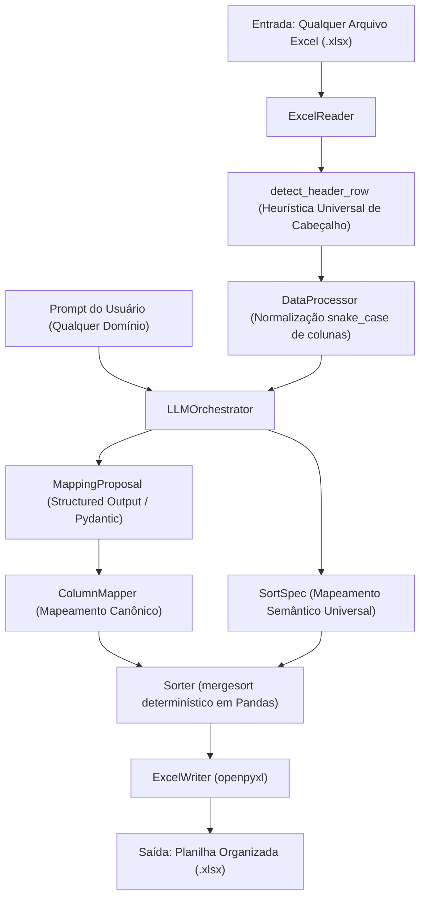
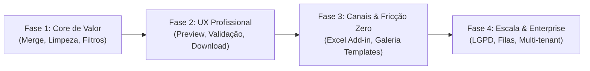

# Análise de Viabilidade Técnica, Financeira e Roadmap de Mercado
**Aplicação:** Organizer App (AI-Assisted Excel Organizer)  
**Data:** 28 de Outubro de 2026 (Atualizado)  
**Status:** Arquitetura Agnóstica & Diagnóstico Estratégico  

---

## Sumário Executivo

O **Organizer App** é uma solução inteligente desenvolvida em Python (Flask, Pandas, LangChain, OpenAI) com frontend em React/Vite, projetada como uma **plataforma horizontal e agnóstica a dados**. Ela lê planilhas Excel heterogêneas de qualquer segmento, normaliza nomes de colunas via inferência semântica e organiza registros com base em instruções em linguagem natural.

* **Viabilidade Financeira:** **Altamente viável**, apresentando margens brutas estimadas superiores a **90%**. O envio restrito de metadados (apenas nomes de colunas e schema) para os LLMs mantém o custo de inferência na ordem de frações de centavo de dólar por planilha.
* **Arquitetura Agnóstica (Horizontal):** O core da aplicação é 100% desacoplado de regras de negócio verticais. Dados de vestuário/uniformes foram utilizados apenas como amostra piloto de validação de heurísticas.
* **Principal Oportunidade:** Expandir o escopo de "apenas ordenação" para **consolidação de abas (merge)**, **limpeza de dados** e distribuição via **Add-in nativo para Microsoft Excel**.

---

## 1. Diagnóstico Técnico da Solução Atual

### 1.1. Arquitetura Horizontal e Fluxo de Execução

### 1.2. Módulos e Componentes Centrais

1. **Leitura Resiliente ([`src/excel_reader.py`](file:///c:/Projetos/organizer-app/src/excel_reader.py)):**
   * Implementa a heurística `detect_header_row`, pontuando linhas candidatas com base em número de células preenchidas, proporção de textos, unicidade dos valores e densidade das linhas seguintes.
   * *Impacto:* Permite ignorar automaticamente relatórios de preâmbulo, metadados ou títulos institucionais antes da tabela real em qualquer tipo de planilha legada.

2. **Orquestração de IA com Interpretação Semântica Universal ([`src/llm_orchestrator.py`](file:///c:/Projetos/organizer-app/src/llm_orchestrator.py)):**
   * Utiliza `with_structured_output` com Pydantic (`MappingProposal` e `SortSpec`).
   * O prompt atua como um tradutor semântico agnóstico: analisa a intenção do usuário em linguagem natural e faz a correlação com as colunas disponíveis, resolvendo siglas, abreviações e sinônimos contextualmente.

3. **Processamento Determinístico ([`src/data_processor.py`](file:///c:/Projetos/organizer-app/src/data_processor.py) e [`src/sorter.py`](file:///c:/Projetos/organizer-app/src/sorter.py)):**
   * A IA não manipula os dados linha a linha; ela apenas instrui o script Pandas sobre *como* mapear e ordenar.
   * *Impacto:* A ordenação usa `mergesort` (estável) localmente, garantindo integridade dos dados, performance e custo de IA nulo durante a etapa de dados.

4. **API e Interface ([`main.py`](file:///c:/Projetos/organizer-app/main.py) e [`front-end/src/App.tsx`](file:///c:/Projetos/organizer-app/front-end/src/App.tsx)):**
   * Backend Flask com documentação OpenAPI/Swagger em `/docs`.
   * Frontend em React + TypeScript com formulário minimalista para upload multipart.

### 1.3. Pontos de Atenção e Débitos Técnicos Identificados

> [!NOTE]
> **Agnosticismo Concluído:** O motor de IA e os fluxos de trabalho foram limpos de referências verticais específicas, operando agora de forma 100% agnóstica a qualquer segmento de mercado.

> [!WARNING]
> * **Escopo Funcional Restrito:** O sistema organiza unicamente através de renomeação de colunas e ordenação (`df.sort_values`). Falta suporte ativo a junção de abas, filtros e transformações de tipo.
> * **Manipulação de Arquivos em Disco:** O backend grava saídas diretamente na pasta `Downloads` da máquina servidora (`Path.home() / "Downloads"`). Em ambiente cloud/produção, deve retornar o binário via stream ou link temporário seguro (S3).
> * **Ausência de Feedback Humano (Human-in-the-Loop):** O usuário não visualiza nem aprova o mapeamento de colunas antes de o arquivo final ser gerado.

---

## 2. Análise de Viabilidade Financeira

### 2.1. Custos Unitários de Operação (Unit Economics)

A decisão de arquitetura de enviar **apenas metadados** (nomes das colunas e instruções) para a LLM, em vez do arquivo de dados completo, torna o consumo de tokens mínimo:

* **Tamanho médio do payload:** ~400 a 800 tokens de entrada (dependendo da quantidade de abas/colunas) e ~100 a 200 tokens de saída estruturada.
* **Total por requisição:** ~1.000 tokens no pior cenário.

#### Estimativa de Custo por Planilha (Modelo `gpt-4o-mini` ou similar moderno):
* Entrada: \$ 0,15 por 1M tokens $\rightarrow$ \$ 0,00012 por arquivo
* Saída: \$ 0,60 por 1M tokens $\rightarrow$ \$ 0,00012 por arquivo
* **Custo estimado por execução de IA:** **~US\$ 0,00025 a US\$ 0,002 (menos de R\$ 0,01 por arquivo)**

| Volume Mensal de Arquivos | Custo Estimado de LLM (USD) | Custo em Reais (aprox.) |
| :--- | :--- | :--- |
| **1.000 planilhas/mês** | ~US\$ 1,50 | ~R\$ 8,50 |
| **10.000 planilhas/mês** | ~US\$ 15,00 | ~R\$ 85,00 |
| **50.000 planilhas/mês** | ~US\$ 75,00 | ~R\$ 425,00 |

### 2.2. Margem Bruta Operacional

Considerando um modelo SaaS com cobrança média de **R\$ 49,00 a R\$ 99,00/mês por usuário** para um limite de até 300 planilhas:
* Custo direto de IA: ~R\$ 1,00 a R\$ 2,00 por usuário/mês.
* Custo de infraestrutura web (Container leve): ~R\$ 3,00 por usuário proporcional.
* **Margem Bruta Estimada:** **> 90%**.

### 2.3. Dor de Mercado e Disposição a Pagar (Willingness to Pay)

* **Problema:** Analistas de negócios, operadores de logística, analistas contábeis e assistentes comerciais gastam entre 4 e 12 horas semanais limpando e cruzando planilhas despadronizadas recebidas de fornecedores, filiais ou sistemas legados.
* **Valor Percebido:** Uma economia de apenas 2 horas semanais de um analista representa um ganho financeiro de mais de R\$ 400,00/mês para a empresa. Portanto, a barreira de preço para assinaturas corporativas de R\$ 49 a R\$ 250/mês é praticamente insignificante perante o ROI imediato.

---

## 3. Próximos Passos para Tornar a Aplicação Atraente ao Mercado

### Fase 1: Expandir a Proposta de Valor (Além da Ordenação)

1. **Consolidação de Múltiplas Abas (Merge Inteligente):**
   * O método [`DataProcessor.merge_frames`](file:///c:/Projetos/organizer-app/src/data_processor.py#L62-L70) já existe no código. É necessário expô-lo no fluxo principal para permitir prompts como: *"Junte todas as abas mensais em uma tabela única padronizada e ordene pela data mais recente"*.
2. **Limpeza e Conversão de Tipos:**
   * Reconhecimento automático e padronização de formatos brasileiros (ex: converter datas para `DD/MM/AAAA` e valores financeiros `R$ 1.500,50` para formato numérico tratável).
   * Remoção automática de linhas vazias, cabeçalhos repetidos no meio do arquivo e deduplicação de registros.
3. **Generalização Total do Prompt:**
   * Concluído: o motor não assume regras de domínio específicas previamente embutidas.

### Fase 2: Experiência do Usuário (Transformar Código em Produto)

1. **Fluxo Real de Download:**
   * Substituir o salvamento local na pasta `Downloads` do servidor por um streaming binário direto via Flask (`send_file`) com download imediato no browser pelo React.
2. **Preview Interativo Antes e Depois:**
   * Adicionar uma visualização em tabela interativa (usando bibliotecas como *AG Grid* ou *TanStack Table*) para que o usuário inspecione o resultado na tela antes de exportar o arquivo.
3. **Validação Humana (Human-in-the-Loop):**
   * Quando o modelo propor o mapeamento de colunas, apresentar uma interface visual simples com a pontuação de confiança:
     * *Exemplo:* "Confirmar mapeamento: `Dt_Venda` $\rightarrow$ `data_pedido` (Confiança: 94%)".
4. **Design Moderno:**
   * Refatorar a interface com Tailwind CSS, adicionando feedback visual durante o upload e mensagens de erro amigáveis.

### Fase 3: Estratégia de Distribuição e Redução de Fricção (Go-To-Market)

1. **Add-in Nativo para Microsoft Excel (Office JavaScript API):**
   * **Maior multiplicador de adoção do projeto:** Usuários corporativos relutam em abrir navegadores externos para subir e baixar arquivos. Um painel lateral integrado dentro do próprio Excel onde o usuário seleciona os dados e digita a instrução tem taxa de retenção infinitamente maior.
2. **Galeria de Casos de Uso / Templates:**
   * Manter o core agnóstico, mas oferecer botões de atalho: *"Conciliação Financeira"*, *"Consolidação de Cotações"*, *"Padronização de Pedidos"*, além do *"Prompt Livre"*.
3. **Integrações de Armazenamento:**
   * Conexão direta com Google Drive e OneDrive/SharePoint para processar arquivos sem download prévio.

### Fase 4: Infraestrutura, Segurança e Monetização

1. **Filas de Processamento Assíncrono:**
   * Para arquivos grandes (> 50.000 linhas), requisições HTTP normais correm risco de timeout. Utilizar workers de background (ex: Celery ou RQ com Redis) e avisar a conclusão via webhook ou SSE.
2. **Privacidade e LGPD:**
   * Implementar política de descarte automático de arquivos processados após 15 minutos.
   * Certificação de que os dados do cliente não são retidos nem utilizados para treinamento de modelos de terceiros (Zero Data Retention).
3. **Precificação e Planos Comerciais Sugeridos:**
   * **Gratuito / Degustação:** Até 3 planilhas por mês (para validação e geração de leads).
   * **Profissional (R\$ 49 a R\$ 79 / mês):** Planilhas ilimitadas, limite de até 50 MB por arquivo, suporte a receitas salvas.
   * **Equipes / Corporativo (R\$ 199 a R\$ 399 / mês):** Múltiplos usuários, suporte prioritário, integração de API e painel administrativo.

---

## Conclusão

O **Organizer App** possui uma base técnica robusta, altamente econômica e agora **genuinamente agnóstica a dados**. 

O caminho para o sucesso comercial combina a flexibilidade de um motor universal com uma estratégia de apresentação focada em casos de uso práticos (templates), resolvendo o gargalo de manipulação manual de planilhas em qualquer departamento.
