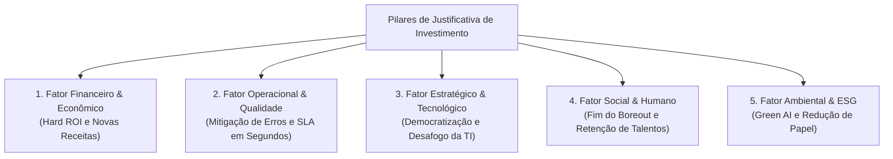
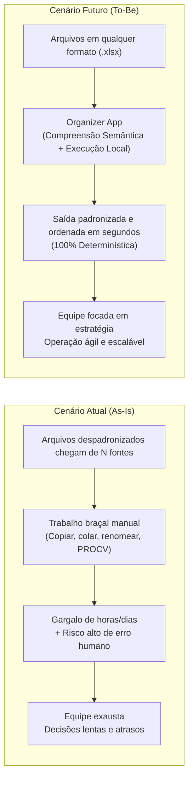

# Análise de Benefícios, Justificativas e Proposta de Valor (Business Case)
**Aplicação:** Organizer App (AI-Assisted Excel Organizer)  
**Data:** 28 de Outubro de 2026  
**Status:** Documento de Justificativa Estratégica e Decisão de Investimento  

---

## Sumário Executivo

O investimento no desenvolvimento e evolução do **Organizer App** é fundamentado em uma análise rigorosa de **retorno sobre o investimento (ROI)**, mitigação de riscos operacionais e melhoria de qualidade de vida do trabalhador corporativo.

A premissa central é a de que o trabalho manual repetitivo de formatação e padronização de dados em planilhas (*Data Wrangling*) representa um dreno financeiro silencioso nas organizações, com custos de homem-hora elevados, altas taxas de erro humano e limitação da capacidade de crescimento das equipes.

A solução proposta apresenta uma arquitetura que combina a **inteligência semântica de Large Language Models (LLM)** com o **rigor matemático e velocidade determinística do processamento local (Pandas)**, entregando uma solução de altíssimo valor agregado com um custo marginal de operação praticamente nulo (< R\$ 0,01 por arquivo).

---

## 1. Fatores Centrais que Justificam o Projeto

A viabilidade e atratividade do projeto apoiam-se em cinco dimensões estratégicas:



---

### 1.1. Fator Financeiro & Econômico (Hard ROI)
* **Eliminação do "Custo Oculto do Excel":** Analistas de negócios, financeiro, compras e logística gastam em média **30% a 40% de suas jornadas** apenas limpando dados, combinando abas e ajustando cabeçalhos de planilhas. Em uma equipe de 4 analistas com salário médio de R\$ 5.000,00, o desperdício de tempo mecânico equivale a mais de **R\$ 80.000,00 ao ano**.
* **Alavancagem de Novas Receitas (Sem inflar a folha):** Em empresas de serviços (como BPO Financeiro, escritórios contábeis e consultorias), a capacidade de aceitar novos contratos é limitada pela quantidade de horas que a equipe gasta digitando e cruzando extratos. Automatizar a ingestão permite que a mesma equipe atenda **até 2x mais clientes**, gerando novas linhas de receita sem novas contratações imediatas.
* **Payback Quase Imediato:** Como a aplicação envia apenas metadados (nomes de colunas e schema) para a IA, o custo unitário por execução é insignificante (< R\$ 0,01 por arquivo). O investimento na ferramenta se paga já nas primeiras semanas de uso real.

---

### 1.2. Fator Operacional & Mitigação de Riscos
* **Blindagem contra o Erro Humano:** Erros manuais no Excel (fórmulas corrompidas como `#N/D`, digitação com vírgula em vez de ponto, linhas desalinhadas) causam prejuízos concretos: pedidos faturados com itens errados, decisões de compras com preços desatualizados e autuações fiscais por relatórios incorretos. A substituição do copia e cola manual por rotinas determinísticas auditáveis reduz o erro a **quase 0%**.
* **Redução Drástica de Ciclo (SLA):** Processos de fechamento mensal ou consolidação de pedidos que levavam de 2 a 3 dias úteis passam a ser executados em **segundos**.

---

### 1.3. Fator Estratégico & Democratização Tecnológica
* **Empoderamento do "Citizen Data Scientist":** Ferramentas tradicionais de engenharia de dados e ETL (como Alteryx, Apache NiFi, scripts Python ou SQL) são caras e exigem profissionais especializados de TI. O Organizer App democratiza a transformação de dados permitindo comandos em **linguagem natural em português**.
* **Desafogamento das Equipes de TI:** A TI corporativa não precisa construir pipelines sob medida para cada novo fornecedor ou parceiro que decide enviar arquivos em formatos próprios.

---

### 1.4. Fator Social & Humano (Saúde Mental e Retenção)
* **Combate ao *Boreout* e ao Burnout:** Obrigar analistas graduados e bem remunerados a realizar trabalho de "robô digitador" gera desmotivação crônica, estresse de fechamento de mês e alta rotatividade (*turnover*).
* **Valorização Profissional:** Liberar o colaborador de tarefas mecânicas permite direcioná-lo para funções analíticas, estratégicas e de atendimento consultivo ao cliente.

---

### 1.5. Fator Ambiental & Sustentabilidade (ESG)
* **Descarte da "Cultura do Papel de Conferência":** Em fábricas, confecções e centros de distribuição, colaboradores frequentemente imprimem planilhas extensas para conferir linha a linha com caneta marca-texto devido à desorganização visual dos arquivos. A padronização digital elimina essa necessidade de impressão.
* **Eficiência Computacional Sustentável (*Green AI*):** A arquitetura híbrida envia apenas metadados para a IA e processa os dados localmente com Pandas, consumindo uma fração mínima da energia e da pegada de carbono computacional de soluções que processam datasets inteiros na nuvem.

---

## 2. Cenário Atual (*As-Is*) vs. Cenário Futuro Esperado (*To-Be*)



### 2.1. Matriz Comparativa de Métricas

| Dimensão | Cenário Atual (*As-Is*) | Cenário Futuro Esperado (*To-Be*) | Benefício / Métrica de Sucesso |
| :--- | :--- | :--- | :--- |
| **Tempo por Arquivo** | De 30 min a 3 horas de manipulação manual no Excel. | **Menos de 15 segundos** para leitura, mapeamento e ordenação. | **Redução de tempo > 95%**. |
| **Confiabilidade dos Dados** | Suscetível a erros de digitação, fórmulas corrompidas e omissão de linhas. | Processamento matemático determinístico auditável via código. | **Taxa de erro operacional próxima de 0%**. |
| **Fricção com Parceiros** | Tentativa inútil de exigir que clientes/fornecedores usem "templates padrão". | **Agnosticismo total:** a empresa aceita a planilha no formato do cliente. | **Melhoria drástica na experiência do cliente/parceiro**. |
| **Escalabilidade da Operação** | Linear: para processar o dobro de planilhas, precisa de mais analistas. | Exponencial: o mesmo software processa 10 ou 1.000 planilhas sem esforço. | **Crescimento de capacidade sem inchaço de folha**. |
| **Satisfação da Equipe** | Sensação de desperdício de potencial profissional em tarefas mecânicas. | Foco em análise de negócio, relacionamento com cliente e decisão. | **Redução de absenteísmo e turnover voluntário**. |
| **Custo de Processamento** | R\$ 25 a R\$ 70 de homem-hora por planilha formatada. | Frações de centavos em chamadas de API (< R\$ 0,01 por arquivo). | **Margem operacional superior a 90%**. |

---

### 2.2. Simulação Prática de Retorno Financeiro (Exemplo PME / BPO)

* **Volume de planilhas processadas:** 200 planilhas/mês.
* **Tempo médio manual:** 40 minutos por planilha = ~133 horas/mês gastas.
* **Custo médio do homem-hora do analista:** R\$ 35,00/hora.
* **Custo operacional atual:** R\$ 4.655,00/mês gastos com formatação manual.
* **Com o Organizer App:**
  * Tempo gasto: 15 segundos por planilha = menos de 1 hora/mês.
  * Custo de IA estimado (200 execuções): menos de R\$ 3,00/mês.
  * Assinatura do software estimada: ~R\$ 99,00 a R\$ 199,00/mês.
* **Economia Líquida Gerada:** **Mais de R\$ 4.400,00 por mês** (mais de R\$ 52.000,00/ano por equipe).

---

## 3. A Proposta de Valor do Produto

A proposta de valor do **Organizer App** resolve a tensão entre a **desordem natural dos dados do mundo real** e a **rigidez necessária para que os sistemas corporativos funcionem**.

### 3.1. Declaração Canônica de Posicionamento (Framework de Geoffrey Moore)

> **Para** profissionais de negócios, analistas operacionais e equipes de backoffice,  
> **Que** perdem horas valiosas e sofrem com erros ao limpar, renomear e ordenar planilhas recebidas de múltiplas fontes,  
> **O Organizer App** é uma plataforma inteligente e agnóstica de organização de planilhas  
> **Que** traduz instruções em linguagem natural em transformações determinísticas imediatas,  
> **Diferente de** ferramentas complexas de engenharia de dados (que exigem programação) ou macros rígidas do Excel (que quebram a qualquer mudança de coluna),  
> **O nosso produto** combina a inteligência semântica da IA generativa com a velocidade e precisão matemática do processamento local, sem exigir nenhum conhecimento técnico do usuário.

---

### 3.2. Os 4 Pilares da Proposta de Valor

```
 ┌────────────────────────────────────────────────────────────────────────┐
 │                      PILARES DA PROPOSTA DE VALOR                      │
 └───────────────────────────────────┬────────────────────────────────────┘
                                     │
    ┌─────────────────┬──────────────┴───────────────┬─────────────────┐
    ▼                 ▼                              ▼                 ▼
[ Fricção Zero ] [ Comando Natural ]       [ Confiança Total ]   [ Hiper-Econômico ]
Aceite planilhas  Peça como se estivesse    IA mapeia o schema;    Custa frações de
de qualquer       falando com um analista   código exato processa  centavo por arquivo
layout sem        humano em português:      os dados (zero         com margens > 90%.
exigir templates  "Ordene por data e valor" alucinações).
```

1. **Fricção Zero na Entrada:** Aceita a bagunça do remetente (cabeçalhos confusos, preâmbulos de relatórios, colunas desordenadas) sem impor formulários chatos que clientes e parceiros raramente preenchem.
2. **Comando em Linguagem Natural:** O usuário não escreve fórmulas nem código; apenas diz o que quer: *"organize por data de faturamento e depois por cliente"*.
3. **Precisão Matemática com Zero Alucinação:** A IA atua onde é brilhante (entender a semântica e os nomes das colunas) e o código Pandas atua onde é imbatível (classificar e manipular números e linhas com 100% de exatidão determinística).
4. **Hiper-eficiência de Custos:** Processamento local e envio mínimo de tokens, garantindo privacidade, velocidade e viabilidade econômica em escala.

---

### 3.3. Canvas da Proposta de Valor (Value Proposition Canvas)

```
        PERFIL DO CLIENTE                            MAPA DE VALOR DO PRODUTO
┌─────────────────────────────────┐           ┌─────────────────────────────────┐
│ TAREFAS DO CLIENTE (Jobs):      │           │ PRODUTOS E SERVIÇOS:            │
│ • Compilar relatórios mensais   │           │ • Motor Agnóstico de Planilhas  │
│ • Conciliar extratos bancários  │           │ • Parser Semântico de Linguagem │
│ • Consolidar cotações e pedidos │           │   Natural                       │
│                                 │           │                                 │
│ DORES (Pains):                  │   AJUSTE  │ ALIVIADORES DE DOR (Relievers): │
│ • Horas perdidas com PROCV      │ <───────> │ • Organização em < 15 segundos  │
│ • Erros manuais e retrabalho    │           │ • Detecção de headers sujos     │
│ • Fórmulas que quebram com      │           │ • Zero necessidade de código/   │
│   qualquer mudança de cabeçalho │           │   fórmulas manuais              │
│                                 │           │                                 │
│ GANHOS ESPERADOS (Gains):       │           │ CRIADORES DE GANHO (Creators):  │
│ • Fechar prazos com folga       │           │ • Alavancagem da capacidade de  │
│ • Focar em análises estratégicas│           │   atendimento sem contratações  │
│ • Confiança total nos números   │           │ • Arquivos prontos p/ ERP/decisão│
└─────────────────────────────────┘           └─────────────────────────────────┘
```

---

## 4. Conclusão da Justificativa de Investimento

O desenvolvimento e a comercialização do **Organizer App** não representam uma inovação especulativa, mas sim a resolução direta de um dos maiores e mais documentados gargalos de produtividade do ambiente corporativo moderno: a manipulação manual de planilhas.

A união de:
1. **Baixo risco e baixo custo de desenvolvimento** (apoiado em bibliotecas maduras como Pandas e modelos de IA altamente acessíveis);
2. **Margens operacionais acima de 90%**;
3. **ROI tangível e imediato para o comprador**;
4. **Impactos positivos diretos no bem-estar das equipes e eficiência operacional**;

justifica amplamente o investimento na evolução contínua da ferramenta, no aprimoramento da sua interface de usuário e na sua distribuição via canais estratégicos (como o suplemento do Microsoft Excel).

