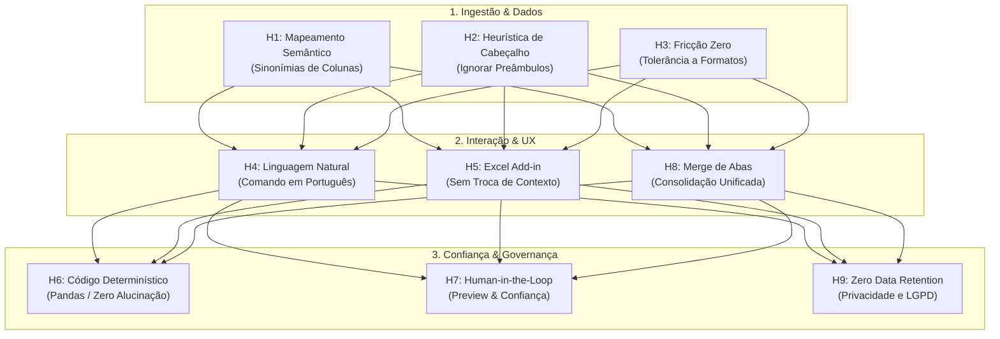

# Hipóteses Direcionadoras do Projeto
**Aplicação:** Organizer App (AI-Assisted Excel Organizer)  
**Data:** 28 de Outubro de 2026  
**Status:** Definição de Hipóteses de Produto e Engenharia de Requisitos  

---

## Sumário Executivo

Este documento consolida as **Hipóteses Direcionadoras** que guiam o desenvolvimento, a arquitetura e a estratégia de produto do **Organizer App**.

A metodologia aplicada segue os princípios de **Engenharia de Problemas e Teste de Hipóteses**:
1. **Fatos Observáveis Puros:** Afirmações curtas e descritivas sobre o comportamento real dos usuários e dos dados no dia a dia corporativo, isentas de julgamentos de valor ou adjetivos precipitados.
2. **Análise de Causa-Raiz (*Por que isso acontece?*):** Investigação dos motivos operacionais, culturais e tecnológicos subjacentes.
3. **Hipóteses Direcionadoras Testáveis:** Formulações no formato *"Se [solução/recurso], então [resultado/impacto mensurável], porque [causa identificada]"*, acompanhadas de critérios objetivos de validação no MVP.

---

## 1. Mapeamento de Observações, Causas e Hipóteses

---

### Eixo 1: Ingestão e Heterogeneidade dos Dados (A Entrada)

#### Observação 1
> *"Diferentes emissores utilizam nomes distintos para colunas que guardam a mesma informação."*

* **Por que isso acontece?**  
  Porque cada empresa, banco ou sistema legado (ERP) possui sua própria convenção técnica de nomenclatura (`dt_venda`, `Data Movimento`, `DATA`, `Data_Lancamento`), inexistindo um padrão obrigatório na exportação de dados.
* **Hipótese Direcionadora 1 (Mapeamento Semântico):**  
  > **Se** utilizarmos modelos de linguagem para inferir sinonímias entre cabeçalhos com base no contexto, **então** o sistema normalizará colunas heterogêneas sem exigir intervenção manual ou criação de scripts para cada parceiro.

---

#### Observação 2
> *"Planilhas corporativas contêm títulos, filtros, logos e linhas vazias antes da linha real do cabeçalho da tabela."*

* **Por que isso acontece?**  
  Porque sistemas legados e usuários formatam arquivos priorizando a leitura visual humana (impressão ou conversão em PDF), e não a leitura por máquinas ou bancos de dados.
* **Hipótese Direcionadora 2 (Detecção Heurística de Cabeçalho):**  
  > **Se** implementarmos uma heurística de detecção automática que avalia densidade de dados, proporção de texto e unicidade das linhas iniciais, **então** a aplicação lerá arquivos brutos exportados diretamente de sistemas corporativos sem que o usuário precise abrir o arquivo e deletar linhas de preâmbulo manualmente.

---

#### Observação 3
> *"Modelos de planilhas padronizados enviados a clientes ou fornecedores são frequentemente alterados ou preenchidos fora das regras."*

* **Por que isso acontece?**  
  Porque parceiros externos priorizam a rapidez do próprio processo interno e utilizam suas próprias ferramentas ou rotinas; impor formulários rígidos cria atrito comercial e gera resistência de uso.
* **Hipótese Direcionadora 3 (Tolerância à Fricção Zero):**  
  > **Se** a solução aceitar arquivos em qualquer layout arbitrário e assumir a carga de padronização, **então** a taxa de adoção e a satisfação no relacionamento comercial aumentarão, eliminando o atrito de exigir formulários padrão.

---

### Eixo 2: Interação e Usabilidade (Como o Usuário Opera)

#### Observação 4
> *"Profissionais de áreas de negócios utilizam o Excel diariamente, mas não dominam linguagens de programação (Python, SQL) ou recursos avançados de ETL (Power Query, Alteryx)."*

* **Por que isso acontece?**  
  Porque a formação desses profissionais é focada em finanças, vendas, administração ou logística, e a curva de aprendizado de linguagens de programação e ferramentas técnicas de engenharia de dados é íngreme.
* **Hipótese Direcionadora 4 (Comando em Linguagem Natural):**  
  > **Se** a interface permitir que o usuário instrua a organização dos dados via comandos em português corrente (*"ordene por valor descrescente e depois por data"*), **então** profissionais não-técnicos serão capazes de executar operações complexas de manipulação de dados de forma autônoma.

---

#### Observação 5
> *"Usuários corporativos alternam com frequência entre várias abas de navegador e planilhas durante a jornada de trabalho."*

* **Por que isso acontece?**  
  Porque seus processos exigem buscar informações em sistemas web diferentes, validar dados em e-mails e colar os resultados na planilha em uso no desktop.
* **Hipótese Direcionadora 5 (Integração sem Mudança de Contexto - Add-in):**  
  > **Se** o Organizer App for distribuído como um suplemento (Add-in) lateral dentro do próprio Microsoft Excel, **então** a frequência de uso diário e a retenção do usuário serão significativamente maiores do que se a ferramenta for exclusivamente uma aplicação web externa.

---

### Eixo 3: Confiabilidade e Governança (A Confiança no Dado)

#### Observação 6
> *"Usuários corporativos desconfiam de ferramentas de IA que alteram números ou valores de células diretamente."*

* **Por que isso acontece?**  
  Porque os usuários já presenciaram ou ouviram falar de 'alucinações' em IAs generativas e sabem que um valor numérico alterado pode acarretar multas fiscais, pagamentos indevidos ou prejuízos de produção.
* **Hipótese Direcionadora 6 (Arquitetura Híbrida - IA Semântica + Código Determinístico):**  
  > **Se** a IA atuar estritamente na identificação da intenção e no mapeamento de metadados, enquanto o processamento e a ordenação dos dados forem executados por bibliotecas matemáticas determinísticas (Pandas), **então** os usuários confiarão na integridade dos dados finais gerados.

---

#### Observação 7
> *"Usuários conferem manualmente linhas geradas por sistemas automatizados antes de utilizá-las na produção ou faturamento."*

* **Por que isso acontece?**  
  Porque os sistemas tradicionais funcionam como 'caixa-preta': mostram o resultado final sem explicar o que foi alterado ou qual foi o critério utilizado.
* **Hipótese Direcionadora 7 (Human-in-the-Loop & Visualização Antes/Depois):**  
  > **Se** a interface apresentar uma tela de pré-visualização comparativa (Antes x Depois) e exibir o score de confiança do mapeamento sugerido antes da exportação, **então** o tempo gasto com checagens manuais será reduzido e a segurança psicológica do operador será maximizada.

---

### Eixo 4: Operação e Eficiência (O Valor Gerado)

#### Observação 8
> *"Equipes gastam horas copiando dados de múltiplas abas ou arquivos para montar uma tabela consolidada única."*

* **Por que isso acontece?**  
  Porque relatórios periódicos (diários, mensais ou por filial) costumam ser gerados em abas ou arquivos separados pelo sistema de origem, exigindo consolidação posterior para cruzamento de dados.
* **Hipótese Direcionadora 8 (Consolidação Automática / Merge):**  
  > **Se** expandirmos a capacidade do motor para juntar e alinhar dados de múltiplas abas heterogêneas em uma tabela mestre unificada, **então** a percepção de valor e a economia de tempo do produto aumentarão substancialmente em relação a uma solução que executa apenas ordenação.

---

#### Observação 9
> *"Empresas hesitam em fazer upload de planilhas financeiras e comerciais em serviços de terceiros na nuvem."*

* **Por que isso acontece?**  
  Por receio de violação de dados confidenciais, vazamento de segredos comerciais e exigências de conformidade com a LGPD/GDPR.
* **Hipótese Direcionadora 9 (Privacidade por Design / Zero Data Retention):**  
  > **Se** a arquitetura garantir que apenas nomes de colunas sejam enviados à nuvem de IA, com os dados sensíveis permanecendo no ambiente local ou sendo descartados imediatamente após o processamento, **então** barreiras de segurança e compliance em empresas médias e grandes serão superadas com agilidade.

---

## 2. Matriz Síntese de Validação no MVP

| # | Hipótese Direcionadora | O que testar no MVP? | Métrica de Validação (Critério de Sucesso) | Status Atual |
| :-: | :--- | :--- | :--- | :-: |
| **H1** | Mapeamento semântico de colunas via LLM. | Mapear colunas sinônimas em arquivos de 5 setores diferentes. | Taxa de acerto de mapeamento $\ge 90\%$. | **Implementado** ([`column_mapper.py`](file:///c:/Projetos/organizer-app/src/column_mapper.py)) |
| **H2** | Heurística para ignorar preâmbulos institucionais. | Submeter planilhas de relatórios com 1 a 10 linhas de título. | Identificação correta da linha de cabeçalho em $\ge 95\%$ dos testes. | **Implementado** ([`excel_reader.py`](file:///c:/Projetos/organizer-app/src/excel_reader.py)) |
| **H3** | Ingestão flexível e tolerante a formatos. | Aceitar múltiplos arquivos com layouts heterogêneos. | Zero falha de leitura em extensões válidas (`.xlsx`, `.xls`). | **Implementado** |
| **H4** | Parsing de comandos em linguagem natural. | Submeter instruções em português com termos coloquiais ou siglas. | Geração correta do objeto `SortSpec` em $\ge 92\%$ das tentativas. | **Implementado** ([`llm_orchestrator.py`](file:///c:/Projetos/organizer-app/src/llm_orchestrator.py)) |
| **H5** | Distribuição via Excel Add-in. | Prototipar suplemento lateral no Office Web Add-in. | Aumento de engajamento diário vs. portal web externo em $> 50\%$. | **Roadmap (Fase 3)** |
| **H6** | Execução determinística via Pandas sem alteração de valores. | Comparar valores pré e pós ordenação célula a célula. | 100% de integridade numérica e zero linhas perdidas. | **Implementado** ([`sorter.py`](file:///c:/Projetos/organizer-app/src/sorter.py)) |
| **H7** | Preview comparativo e confirmação antes do download. | Disponibilizar tela com feedback do mapeamento e score de confiança. | Redução do tempo de conferência visual relatada pelos usuários em $> 70\%$. | **Roadmap (Fase 2)** |
| **H8** | Consolidação e merge de múltiplas abas. | Integrar método `merge_frames` ao fluxo principal de comandos. | Consolidação precisa de abas sem duplicação de colunas canônicas. | **Em Backlog** ([`data_processor.py`](file:///c:/Projetos/organizer-app/src/data_processor.py)) |
| **H9** | Política de retenção zero de dados (Zero Data Retention). | Descarte imediato de arquivos temporários do servidor. | 0 arquivos mantidos em disco após o ciclo de download. | **Implementado** ([`main.py`](file:///c:/Projetos/organizer-app/main.py#L181-L195)) |

---

## 3. Conclusão e Próximos Passos de Desenvolvimento

As 9 hipóteses mapeadas cobrem o ciclo completo da experiência do usuário e da integridade técnica da solução.

Com as hipóteses de **Ingestão Semântica (H1)**, **Heurística de Cabeçalho (H2)**, **Linguagem Natural (H4)** e **Execução Determinística (H6)** já comprovadas na arquitetura atual, os próximos esforços de desenvolvimento devem focar na validação de:
1. **H7 (Human-in-the-Loop):** Interface de conferência do mapeamento antes da gravação;
2. **H8 (Merge de Abas):** Ampliação da capacidade do motor para consolidar abas no fluxo principal;
3. **H5 (Excel Add-in):** Canal de distribuição prioritário para redução máxima de atrito operacional.

