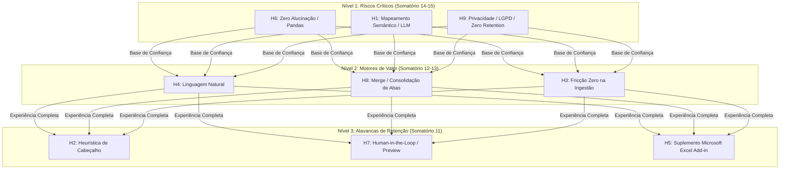

# Matriz de Observação e Criterização das Hipóteses (GUT e Risco)
**Aplicação:** Organizer App (AI-Assisted Excel Organizer)  
**Data:** 28 de Outubro de 2026  
**Status:** Matriz de Priorização de Hipóteses e Gestão de Riscos  

---

## Sumário Executivo

Esta matriz avalia as **9 Hipóteses Direcionadoras do Organizer App** estruturadas a partir de cenários observados no ambiente corporativo real. 

A metodologia de pontuação adota o modelo **GUT (Gravidade, Urgência e Tendência)** adaptado à avaliação de incertezas e riscos de produto, permitindo ordenar quais hipóteses demandam validação primária no MVP e quais mitigam os maiores riscos operacionais do negócio.

---

## 1. Critérios de Avaliação

* **Gravidade (G - 1 a 5):** O impacto no negócio ou no produto se a hipótese for falsa ou o problema ignorado.
  * *1 = Dano mínimo / irrelevante; 5 = Dano catastrófico / bloqueador de adoção.*
* **Urgência (U - 1 a 5):** A necessidade de validação temporal imediata no ciclo de desenvolvimento.
  * *1 = Pode aguardar fases posteriores; 5 = Requer ação/validação imediata no MVP.*
* **Tendência (T - 1 a 5):** A probabilidade e velocidade de piora do cenário caso não seja solucionado.
  * *1 = Não piora ou desaparece; 5 = Piora exponencialmente e aumenta custos rapidamente.*
* **Somatório:** $G + U + T$ (Variação de 3 a 15).
* **Grau de Risco:** 
  * **Alto:** Somatório $\ge 14$ (Risco crítico que invalida a proposta de valor se falhar).
  * **Médio:** Somatório entre 11 e 13 (Risco moderado com impacto direto na retenção e usabilidade).
  * **Baixo:** Somatório $\le 10$ (Oportunidades de refinamento com baixa ameaça operacional).

---

## 2. Matriz de Observação das Hipóteses

| Observação (Cenário Observado) | Descrição da Hipótese | Gravidade (G) 1 a 5 | Urgência (U) 1 a 5 | Tendência (T) 1 a 5 | Somatório (G + U + T) | Priorização | Grau de Risco (Baixo, Médio, Alto) |
| :--- | :--- | :---: | :---: | :---: | :---: | :---: | :---: |
| **Usuários desconfiam de IAs que alteram valores ou números diretamente em planilhas.** | **H6 (Código Determinístico):** Se a IA atuar no mapeamento do schema e o processamento for executado por código determinístico (Pandas), os usuários confiarão na integridade matemática dos dados (zero alucinação). | **5** | **5** | **5** | **15** | **1º** | **Alto** |
| **Diferentes emissores utilizam nomes distintos para colunas com a mesma informação.** | **H1 (Mapeamento Semântico):** Se utilizarmos LLMs para inferir sinonímias entre cabeçalhos via contexto, o sistema normalizará colunas heterogêneas sem exigir regras manuais para cada fornecedor. | **5** | **5** | **4** | **14** | **2º** | **Alto** |
| **Empresas hesitam em subir dados comerciais e financeiros em nuvens de terceiros.** | **H9 (Privacidade e Zero Data Retention):** Se a arquitetura enviar apenas nomes de colunas para a IA e descartar arquivos imediatamente após o download, superaremos exigências de compliance e LGPD. | **5** | **4** | **5** | **14** | **3º** | **Alto** |
| **Usuários de negócios não sabem programar nem dominam ferramentas de ETL avançadas.** | **H4 (Comando em Linguagem Natural):** Se a interface permitir instruções em português corrente (*"ordene por valor descrescente e data"*), não-programadores manipularão dados complexos com autonomia. | **5** | **4** | **4** | **13** | **4º** | **Médio** |
| **Equipes gastam horas copiando dados de múltiplas abas para criar uma tabela consolidada.** | **H8 (Merge de Abas / Consolidação):** Se o motor automatizar a junção e o alinhamento de abas heterogêneas em uma tabela mestre unificada, a percepção de valor aumentará muito além da simples ordenação. | **4** | **4** | **4** | **12** | **5º** | **Médio** |
| **Modelos de planilhas padronizados enviados a parceiros são preenchidos fora das regras.** | **H3 (Fricção Zero / Formatos Livres):** Se a solução aceitar arquivos em qualquer layout arbitrário e assumir a padronização, a adoção aumentará eliminando o atrito de exigir formulários padrão. | **4** | **4** | **4** | **12** | **6º** | **Médio** |
| **Planilhas contêm títulos, logos e linhas vazias antes da linha real do cabeçalho.** | **H2 (Heurística de Cabeçalho):** Se implementarmos detecção de cabeçalho por densidade e unicidade de texto, o sistema lerá relatórios exportados sem necessidade de limpeza prévia de linhas. | **4** | **4** | **3** | **11** | **7º** | **Médio** |
| **Usuários conferem manualmente linhas geradas por sistemas automatizados.** | **H7 (Human-in-the-Loop):** Se a interface exibir um preview comparativo (Antes x Depois) e o score de confiança do mapeamento, o tempo de checagem manual será reduzido com segurança psicológica. | **4** | **4** | **3** | **11** | **8º** | **Médio** |
| **Usuários alternam com frequência entre abas de navegador e o Excel no desktop.** | **H5 (Distribuição via Excel Add-in):** Se o produto for distribuído como suplemento lateral nativo no próprio Microsoft Excel, a frequência de uso diário e a retenção serão superiores a uma página web. | **4** | **3** | **4** | **11** | **9º** | **Médio** |

---

## 3. Análise dos Resultados e Ações Recomendadas

### 3.1. Nível 1: Riscos Críticos e Não Negociáveis (Prioridades 1º a 3º)
* **H6 (Execução Determinística):** A IA não pode ter autonomia para editar os valores das linhas. O uso do Pandas via [`src/sorter.py`](file:///c:/Projetos/organizer-app/src/sorter.py) com `mergesort` garante exatidão matemática estrita.
* **H1 (Mapeamento Semântico):** Normalização canônica via [`src/column_mapper.py`](file:///c:/Projetos/organizer-app/src/column_mapper.py) e Pydantic [`src/validators.py`](file:///c:/Projetos/organizer-app/src/validators.py). Se o mapeamento de colunas falhar, todo o processamento subsequente falha.
* **H9 (Privacidade / Zero Data Retention):** O envio restrito de metadados à nuvem e a remoção imediata dos arquivos temporários após o ciclo de download em [`main.py`](file:///c:/Projetos/organizer-app/main.py#L181-L195) eliminam os riscos regulatórios com LGPD.

### 3.2. Nível 2: Drivers de Monetização e Eficiência (Prioridades 4º a 6º)
* **H4 (Linguagem Natural):** O parser de comandos em [`src/llm_orchestrator.py`](file:///c:/Projetos/organizer-app/src/llm_orchestrator.py#L57-L79) converte instruções em linguagem comum no objeto `SortSpec`, eliminando a necessidade de conhecimento técnico do usuário.
* **H8 (Merge de Abas):** O código já possui a base implementada em [`src/data_processor.py#merge_frames`](file:///c:/Projetos/organizer-app/src/data_processor.py#L62-L70). A próxima sprint de desenvolvimento deve expor esse método no endpoint principal `/organize` para consolidar abas automaticamente.
* **H3 (Fricção Zero):** A tolerância a formatos diversos consolida a vantagem competitiva sobre sistemas que exigem templates rígidos.

### 3.3. Nível 3: Retenção e Experiência do Usuário (Prioridades 7º a 9º)
* **H2 (Heurística de Cabeçalho):** Concluído e testado em [`src/excel_reader.py`](file:///c:/Projetos/organizer-app/src/excel_reader.py#L42-L75).
* **H7 (Human-in-the-Loop):** Apresentar tela de confirmação do mapeamento antes da gravação do arquivo, aumentando a segurança psicológica do operador.
* **H5 (Excel Add-in):** Distribuição do produto diretamente na barra lateral do Microsoft Excel via Office JavaScript API, integrando a ferramenta à rotina de trabalho sem fricção de navegação externa.

