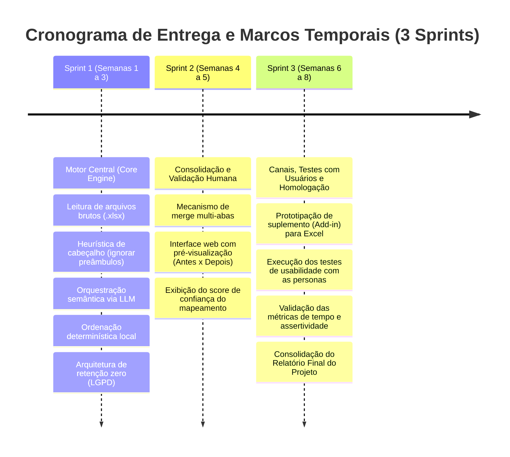

# Definição e Análise do Objetivo SMART do Projeto
**Projeto Aplicado:** Organizer App — Organizador Inteligente de Dados e Planilhas  
**Instituição:** XP Educação (XPE) — Pós-Graduação em Inteligência Artificial e Engenharia de Software  
**Data:** 31 de Outubro de 2026  
**Status:** Documento de Planejamento Estratégico (Seção 1.2.1 do Relatório)

---

## 1. Visão Geral e Importância da Metodologia SMART

No contexto do **Projeto Aplicado**, a definição de um **Objetivo SMART** tem como propósito estabelecer uma meta clara, estruturada e desprovida de ambiguidades, conectando o problema diagnosticado no Capítulo 1 (*Desafio, Personas e Justificativas*) às entregas práticas que serão testadas e comprovadas no Capítulo 2 (*Área de Experimentação*).

A metodologia SMART exige que a meta seja formulada sob cinco critérios complementares:
* **S (Specific – Específico):** O resultado esperado deve ser delimitado com exatidão, sem margem para generalismos como "otimizar dados" ou "criar uma IA".
* **M (Measurable – Mensurável):** Deve conter métricas quantificáveis que permitam comprovar numericamente o sucesso ou fracasso da solução.
* **A (Attainable – Atingível):** Deve ser factível com os recursos computacionais, financeiros e humanos disponíveis no horizonte do projeto acadêmico.
* **R (Relevant – Relevante):** Deve resolver um problema crítico e prioritário do negócio, gerando impacto tangível (financeiro, operacional ou humano).
* **T (Time-based – Temporal):** Deve estabelecer um limite temporal claro e marcos intermediários vinculados aos ciclos das Sprints de desenvolvimento.

---

## 2. Declaração Canônica do Objetivo SMART

> ### 🎯 Declaração Oficial do Objetivo do Projeto
>
> **"Desenvolver e validar, ao longo de 3 Sprints (6 a 8 semanas) durante o ciclo do Projeto Aplicado, um Produto Mínimo Viável (MVP) da aplicação 'Organizer App' — composta por motor híbrido desacoplado (interpretação semântica de schema via LLM e execução algorítmica determinística local) e interface web responsiva —, capaz de automatizar a higienização, mapeamento de cabeçalhos e ordenação de planilhas heterogêneas (.xlsx) de até 10.000 linhas em menos de 15 segundos por arquivo, alcançando taxa de acerto semântico de colunas $\ge 90\%$, compreensão de comandos em português $\ge 92\%$, integridade matemática estrita de 100% dos dados (zero alucinação numérica) e descarte imediato dos arquivos temporários (Zero Data Retention), validando a redução do tempo de manipulação manual em pelo menos 70% perante operadores de teste das personas priorizadas."**

---

## 3. Análise Aprofundada dos Cinco Pilares SMART

```
                   ESTRUTURA DO OBJETIVO SMART — ORGANIZER APP
┌─────────────────────────────────────────────────────────────────────────────┐
│ S • ESPECÍFICO      MVP híbrido: parser de schema via LLM + ordenação       │
│                     determinística local + tolerância a cabeçalhos sujos.   │
├─────────────────────────────────────────────────────────────────────────────┤
│ M • MENSURÁVEL      < 15s/arquivo | ≥ 90% acerto semântico | ≥ 92% NLP      │
│                     100% integridade numérica | > 70% redução de tempo.     │
├─────────────────────────────────────────────────────────────────────────────┤
│ A • ATINGÍVEL       Arquitetura modular em Python/Pandas + chamadas LLM     │
│                     restritas a metadados (< R$ 0,01/req) em 3 Sprints.     │
├─────────────────────────────────────────────────────────────────────────────┤
│ R • RELEVANTE       Elimina 30-40% de tempo gasto em data wrangling braçal  │
│                     e blinda o negócio contra prejuízos de erro humano.     │
├─────────────────────────────────────────────────────────────────────────────┤
│ T • TEMPORAL        Execução e homologação em 3 Sprints (6 a 8 semanas)     │
│                     conforme cronograma do Projeto Aplicado.                │
└─────────────────────────────────────────────────────────────────────────────┘
```

---

### 3.1. S — Specific (Específico)

O objetivo evita afirmações vagas como *"melhorar a rotina do Excel"* ou *"criar um assistente inteligente"*. Ele delimita com exatidão a natureza da solução, os tipos de dados tratados e os componentes a serem desenvolvidos:

* **O que será desenvolvido:**
  * Um MVP de software com arquitetura híbrida dividida em duas camadas fundamentais:
    1. **Camada de Interpretação Semântica (IA):** Utilização de modelos de linguagem para inferir intenções de organização fornecidas pelo usuário em linguagem natural (português corrente) e correlacionar cabeçalhos heterogêneos/sinônimos ao schema canônico desejado.
    2. **Camada de Processamento Determinístico Local:** Execução algorítmica local de manipulação tabular (detecção de cabeçalho com pré-requisito de corte de linhas de ruído, renomeação de colunas e ordenação multi-critério estável).
  * Uma interface web de autosserviço (upload de arquivo, campo de instrução textual em linguagem natural e download do binário processado).
  * Mecanismo de governança com descarte seguro e imediato de dados temporários (Zero Data Retention).
* **O que NÃO está no escopo deste objetivo (Delimitação Negativa):**
  * Não contempla criação ou treinamento de um modelo de fundação proprietário de IA a partir do zero.
  * Não contempla suporte imediato a arquivos legados de bancos de dados relacionais complexos ou formatos proprietários binários antigos (foco estrito no padrão `.xlsx`/`.xls`).
  * Não contempla módulos de ERP financeiro completos, mantendo-se estritamente como ferramenta horizontal de organização e produtividade de dados.

---

### 3.2. M — Measurable (Mensurável)

Para permitir a auditoria objetiva dos resultados na *Área de Experimentação*, o objetivo estabelece métricas quantitativas e critérios de aceite técnicos e de negócio:

| Indicador (KPI) | Parâmetro Mensurado | Meta Numérica de Aceite | Método de Verificação Experimental |
| :--- | :--- | :---: | :--- |
| **Tempo de Execução (SLA)** | Duração total do ciclo (leitura + inferência semântica + ordenação + escrita). | **$< 15$ segundos** por arquivo (até 10.000 linhas) | Medição de tempo de processamento (*timestamp* de início e conclusão). |
| **Acurácia Semântica de Schema** | Taxa de correlação correta de colunas sinônimas em planilhas heterogêneas. | **$\ge 90\%$** de assertividade | Teste cego com 20 planilhas de 5 setores com cabeçalhos divergentes. |
| **Interpretação de Comandos (NLP)** | Tradução de comandos em português livre para especificações estruturadas de ordenação. | **$\ge 92\%$** de sucesso | Submissão de 50 prompts variados (termos coloquiais, siglas e múltiplos critérios). |
| **Integridade dos Dados Numéricos** | Verificação de precisão e ausência de alucinações matemáticas nas linhas. | **$100\%$** de integridade matemática | Comparação automática célula a célula (*hash* / assertiva matemática) antes e após a ordenação. |
| **Conformidade de Privacidade** | Eliminação de arquivos de dados do cliente do ambiente do servidor após processamento. | **$0$** arquivos retidos pós-download | Auditoria de diretório temporal de arquivos pós-requisição. |
| **Impacto no Tempo do Operador** | Redução do tempo gasto na formatação em comparação com a manipulação manual no Excel. | **$\ge 70\%$** de redução de tempo | Teste comparativo cronometrado com usuários das personas prioritárias. |

---

### 3.3. A — Attainable (Atingível)

A meta é plenamente viável dentro das restrições do Projeto Aplicado, considerando tecnologia, capacidade de engenharia e orçamento:

* **Viabilidade Tecnológica:**
  * O projeto não reinventa bibliotecas de manipulação de dados; apoia-se em tecnologias maduras, estáveis e amplamente testadas no ecossistema Python (como Pandas e bibliotecas de manipulação de planilhas).
  * A inteligência semântica utiliza APIs de Large Language Models já consolidadas no mercado com capacidade nativa de geração de saídas estruturadas (*Structured Outputs*), eliminando a necessidade de infraestrutura cara de processamento ou treinamento de redes neurais profundas.
* **Viabilidade Financeira (Unit Economics):**
  * A arquitetura desenhada envia **apenas metadados** (nomes de colunas e schema) para a nuvem da IA, mantendo os dados das linhas locais. Isso restringe o tráfego a menos de 1.000 tokens por requisição, resultando em custo marginal de inferência inferior a **R$ 0,01 por arquivo processado**.
* **Viabilidade de Escopo e Recursos:**
  * O desenvolvimento está planejado para ser executado por equipe individual/reduzida dentro de um ambiente de desenvolvimento padrão, sem dependência de hardware especializado (GPUs dedicadas), pois a inferência roda via API e a ordenação local é leve.

---

### 3.4. R — Relevant (Relevante)

O objetivo ataca diretamente a dor central investigada e quantificada na *Análise de Contexto* e nas *Justificativas*:

* **Alinhamento com as Dores Reais do Mercado:**
  * Pesquisas qualitativas evidenciaram que analistas perdem entre **30% e 40% de sua jornada semanal** executando tarefas mecânicas de *data wrangling* (PROCV, ajustes manuais de cabeçalhos, filtros e consolidações).
  * Reduzir esse ciclo para menos de 15 segundos devolve às organizações mais de R$ 80.000,00 anuais por equipe em produtividade analítica recuperada.
* **Blindagem de Riscos Operacionais:**
  * Erros de digitação, fórmulas corrompidas (`#N/D`, `#REF!`) e inversão de colunas provocam cortes errados de tecidos na indústria têxtil, fretes contratados por valores incorretos na logística e balancetes fiscais com inconsistências na contabilidade.
  * O processamento algorítmico determinístico assegura **zero risco de alucinação numérica**, conferindo segurança jurídica e operacional ao negócio.
* **Democratização da Engenharia de Dados:**
  * O recurso de comandos em linguagem natural permite que colaboradores sem conhecimento de programação (*Citizen Data Scientists*) operem transformações complexas sem depender da sobrecarregada equipe de TI.

---

### 3.5. T — Time-based (Temporal)

O cronograma do objetivo é temporalmente delimitado pelas **3 Sprints do Projeto Aplicado**, com duração total estimada entre **6 e 8 semanas**:



* **Marco Sprint 1 (Semanas 1 a 3):** Validação técnica das hipóteses fundacionais (H6, H1, H9, H4, H3, H2) em ambiente de backend com testes unitários e de integração de arquivos.
* **Marco Sprint 2 (Semanas 4 a 5):** Validação funcional de consolidação de abas (H8) e prototipagem da interface com validação humana e pré-visualização (H7).
* **Marco Sprint 3 (Semanas 6 a 8):** Prototipação do canal nativo de distribuição (H5) e condução das rodadas de testes de aceitação com operadores reais, culminando na homologação das métricas SMART.

---

## 4. Matriz de Rastreabilidade SMART vs. Hipóteses do Projeto

A tabela a seguir demonstra como cada critério do Objetivo SMART ancora-se nas **Hipóteses Direcionadoras** estabelecidas na Seção 1.1.4:

| Dimensão SMART | Elemento do Objetivo | Hipóteses Direcionadoras Vinculadas |
| :---: | :--- | :---: |
| **S** (Específico) | Arquitetura híbrida: LLM para schema + Algoritmo determinístico local + Heurística de pré-requisito de cabeçalhos. | **H1**, **H2**, **H4**, **H6** |
| **M** (Mensurável) | SLA $< 15$s, Acurácia $\ge 90\%$, NLP $\ge 92\%$, Integridade de $100\%$ e Redução de tempo $\ge 70\%$. | **H1**, **H4**, **H6**, **H7** |
| **A** (Atingível) | Custo $< \text{R\$} 0,01$/arquivo, tráfego exclusivo de metadados, escopo delimitado em 3 Sprints ágeis. | **H1**, **H6**, **H9** |
| **R** (Relevante) | Eliminação do trabalho braçal de planilhas, blindagem contra erro humano e descarte imediato LGPD. | **H3**, **H6**, **H8**, **H9** |
| **T** (Temporal) | Entrega sequencial em 3 Sprints planejadas durante o ciclo acadêmico do Projeto Aplicado. | **H1** a **H9** (Roadmap) |

---

## 5. Versão Sintética para Inserção Direta no Relatório (Item 1.2.1)

Para o preenchimento da seção **1.2.1 Objetivo SMART** do documento `Relatório do Projeto Aplicado.docx`, recomenda-se a utilização do texto consolidado abaixo:

> **Objetivo SMART do Projeto Aplicado:**
> 
> "Desenvolver e validar, no período de 3 Sprints (6 a 8 semanas) durante o Projeto Aplicado, um Produto Mínimo Viável (MVP) da aplicação *Organizer App*, provido de arquitetura híbrida (mapeamento semântico de schema e intenções via modelo de linguagem e ordenação algorítmica determinística local) e interface web responsiva, capaz de:
> 1. **(S - Específico):** Ingerir planilhas heterogêneas no formato `.xlsx`, ignorar automaticamente preâmbulos de relatórios institucionais via detecção heurística de cabeçalho, interpretar comandos de organização em português corrente e gerar uma planilha padronizada e ordenada com política de descarte imediato de arquivos temporários.
> 2. **(M - Mensurável):** Processar pastas de trabalho de até 10.000 linhas em menos de 15 segundos, alcançando taxa de acerto no mapeamento semântico de cabeçalhos $\ge 90\%$, índice de interpretação correta de comandos em linguagem natural $\ge 92\%$, garantia matemática estrita de integridade de 100% dos dados numéricos (zero alucinação) e redução do tempo de manipulação manual $\ge 70\%$ nos testes com usuários.
> 3. **(A - Atingível):** Viabilizar a solução através de bibliotecas estáveis de processamento tabular em Python combinadas com chamadas estruturadas de API de IA restritas a metadados, operando com custo computacional inferior a R$ 0,01 por execução e escopo modular factível.
> 4. **(R - Relevante):** Eliminar o desperdício de 30% a 40% da jornada de trabalho de analistas de negócios consumida em formatação braçal de dados, prevenindo prejuízos financeiros causados por erros humanos em planilhas e assegurando conformidade rigorosa com a LGPD.
> 5. **(T - Temporal):** Concluir a implementação e validação experimental ao longo de 3 Sprints estruturadas (Sprint 1: Motor Central e Segurança; Sprint 2: Consolidação e Validação Humana; Sprint 3: Add-in e Homologação com Personas) até o encerramento do ciclo do Projeto Aplicado."

