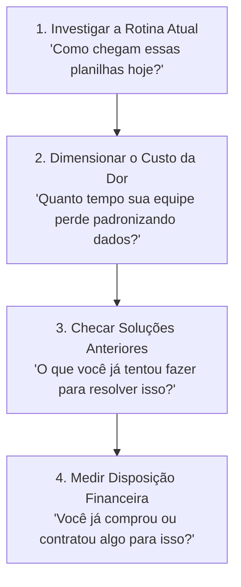

# Plataforma Horizontal Agnóstica: Personas, Mapas de Empatia e Validação
**Aplicação:** Organizer App (AI-Assisted Excel Organizer)  
**Data:** 28 de Outubro de 2026 (Atualizado)  
**Objetivo:** Definir os perfis de clientes (ICP), mapear sua psicologia com Mapas de Empatia e estruturar a estratégia de validação para um **Motor Horizontal e Agnóstico a Dados**.

---

## Sumário Executivo

O **Organizer App** é concebido como uma **ferramenta horizontal de produtividade de dados (Data-Agnostic Engine)**, comparável na sua proposta de versatilidade a soluções como *Airtable*, *Zapier* ou *Notion*. 

O sistema não possui inteligência restrita a um único setor; em vez disso, atua como um tradutor semântico universal capaz de interpretar e organizar planilhas de qualquer natureza (financeira, logística, comercial, industrial, eventos, etc.).

A estratégia comercial adota o modelo **"Motor Agnóstico + Galeria de Casos de Uso (Templates)"**:
* **O Motor:** Um pipeline único em Python (Pandas + LLM) desacoplado de regras de negócio fixas.
* **Os Casos de Uso de Demonstração:** Perfis específicos onde a dor do "Excel manual" é aguda, servindo como portas de entrada para validação de mercado e aquisição de clientes.

```
                            ┌────────────────────────────────────────┐
                            │      MOTOR CENTRAL DA APLICAÇÃO        │
                            │  (100% Agnóstico / Pandas + LLM)       │
                            └───────────────────┬────────────────────┘
                                                │
             ┌──────────────────┬───────────────┴───────────────┬──────────────────┐
             ▼                  ▼                               ▼                  ▼
     [ Caso: Finanças ]  [ Caso: Vendas ]              [ Caso: Logística ]   [ Modo Livre ]
     Extratos bancários,  Consolidação de pedidos,      Tabelas de frete,     Qualquer planilha
     DRE e conciliações   rotas de representantes       cotações de insumos   com prompt aberto
```

---

## 1. Avaliação Crítica das Hipóteses Iniciais

### Hipótese A: Vendedor Autônomo / Representante Comercial
* **Diagnóstico:** A dor de receber pedidos via mensagens desestruturadas de WhatsApp é real e diária.
* **Porém:** O vendedor autônomo tem baixa disposição a pagar por ferramentas do próprio bolso, e o MVP atual exige arquivo Excel.
* **Ajuste:** Foco no **Supervisor / Coordenador de Vendas da Distribuidora/Fábrica**, que centraliza pedidos de dezenas de representantes e arca com o custo de devoluções e erros de expedição.

### Hipótese B: Analista de Dados Técnico
* **Diagnóstico:** Analistas de dados dominam linguagens de programação (Python, SQL, R, dbt) e recursos como Power Query.
* **Porém:** Analistas técnicos preferem criar seus próprios scripts para manter governança de schema e costumam ter restrições a automações de IA de "caixa-preta".
* **Ajuste:** Foco no **Analista de Negócios / Financeiro / Operações (Citizen Data Scientist)**. Este profissional vive no Excel, não sabe programar, depende de fórmulas complexas que quebram com frequência e vê a IA como um multiplicador de produtividade indispensável.

---

## 2. Perfis de Casos de Uso (Demonstração da Versatilidade)

Os perfis abaixo ilustram como o mesmo motor agnóstico resolve problemas reais em áreas distintas:

---

### Caso de Uso 1: O Gestor de Confecção, Brindes e Eventos
* **Nome / Perfil:** "Carlos", 44 anos — Sócio/Diretor de Operações de confecção de uniformes e brindes corporativos.
* **Contexto:** Recebe listas de participantes com grades de tamanhos, cidades e nomes para personalização em planilhas sem padrão.
* **Job To Be Done (JTBD):** *"Quando eu receber listas de pedidos de diferentes clientes, quero transformá-las em um layout único de corte por grade e cidade em segundos, para que a fábrica não produza peças erradas."*
* **Formato de Entrada:** Planilhas Excel com cabeçalhos bagunçados e preâmbulos institucionais.
* **Disposição a Pagar:** **R\$ 89,00 a R\$ 199,00/mês**.

---

### Caso de Uso 2: A Coordenadora de BPO Financeiro e Contabilidade
* **Nome / Perfil:** "Mariana", 35 anos — Líder de Operações em empresa de terceirização de gestão financeira (BPO).
* **Contexto:** Gerencia conciliações de 25 a 40 clientes PMEs todo início de mês, lidando com extratos bancários de dezenas de instituições com layouts distintos.
* **Job To Be Done (JTBD):** *"Quando chegar o início do mês, quero padronizar e consolidar extratos e relatórios de clientes em um formato contábil padrão em segundos, para que minha equipe atenda o dobro de clientes sem fazer hora extra."*
* **Formato de Entrada:** Extratos `.xlsx`/`.csv` de internet banking e relatórios de ERPs com cabeçalhos múltiplos.
* **Disposição a Pagar:** **R\$ 199,00 a R\$ 490,00/mês (Plano Escritório)**.

---

### Caso de Uso 3: O Coordenador de Compras e Logística (Supply Chain)
* **Nome / Perfil:** "Rodrigo", 39 anos — Responsável por aquisições e fretes em indústria ou distribuidora.
* **Contexto:** Envia solicitações de cotação para 8 a 15 transportadoras e dezenas de fornecedores, recebendo planilhas de formatos incompatíveis.
* **Job To Be Done (JTBD):** *"Quando eu receber tabelas de preços de diferentes parceiros, quero normalizar as colunas e ordenar por melhor custo-benefício em minutos, para aprovar compras com o melhor preço do mercado."*
* **Formato de Entrada:** Arquivos Excel heterogêneos recebidos por e-mail.
* **Disposição a Pagar:** **R\$ 250,00 a R\$ 590,00/mês**.

---

## 3. Mapas de Empatia das Personas

Os mapas abaixo traduzem a vivência sensorial, psicológica e comportamental de cada perfil, servindo de base para campanhas de marketing, copywriting e design de produto.

---

### 3.1. Mapa de Empatia: "Carlos" (Gestor de Confecção / Eventos / Brindes)

```
                       ┌─────────────────────────────────────────────────────────┐
                       │                  O QUE PENSA E SENTE?                   │
                       │ • "Não posso deixar sair nada errado para a estamparia."│
                       │ • Sensação de exaustão por perder tardes no Excel.      │
                       │ • Medo de a produção atrasar e o cliente cancelar.      │
                       │ • Deseja profissionalizar a fábrica e focar nas vendas. │
                       └────────────────────────────┬────────────────────────────┘
                                                    │
         ┌──────────────────────────────────┐       │       ┌──────────────────────────────────┐
         │           O QUE OUVE?            │       │       │            O QUE VÊ?             │
         │ • Cliente: "Minha remessa sai    │<──────┼──────>│ • Planilhas tortas, sem padrão,  │
         │   na sexta sem falta, né?"       │       │       │   com células mescladas e cores. │
         │ • Cortador: "Chefe, faltou grade │       │       │ • Cortadores esperando a OP.     │
         │   G nessa lista da escola X!".   │       │       │ • Pilhas de tecido parado.       │
         │ • Parceiros reclamando de prazos.│       │       │ • WhatsApp apitando mensagens.   │
         └──────────────────────────────────┘       │       └──────────────────────────────────┘
                                                    │
                       ┌────────────────────────────┴────────────────────────────┐
                       │                   O QUE FALA E FAZ?                     │
                       │ • Fala: "Nenhum cliente sabe preencher uma planilha!".  │
                       │ • Faz: Abre o Excel, copia e cola na mão, soma na       │
                       │   calculadora e imprime a folha de corte em papel.      │
                       │ • Passa a tarde conferindo nomes e tamanhos um a um.    │
                       └─────────────────────────────────────────────────────────┘
                       ┌────────────────────────────┬────────────────────────────┐
                       │           DORES            │           GANHOS           │
                       │ • Prejuízo com peças       │ • Grade somada e pronta    │
                       │   produzidas no tamanho    │   em 10 segundos.          │
                       │   errado (prejuízo seu).   │ • Produção rodando sem     │
                       │ • Gargalo de conferência.  │   paradas por dúvida.      │
                       │ • Falta de tempo p/ vender.│ • Entrega 100% no prazo.   │
                       └────────────────────────────┴────────────────────────────┘
```

> **Gatilho de Venda para Carlos:**  
> *"Pare de perder horas somando grades e correndo risco de cortar tecido errado. Arraste as listas dos seus clientes e gere a Ordem de Corte organizada por tamanho e cidade em 10 segundos."*

---

### 3.2. Mapa de Empatia: "Mariana" (Coordenadora de BPO Financeiro / Contábil)

```
                       ┌─────────────────────────────────────────────────────────┐
                       │                  O QUE PENSA E SENTE?                   │
                       │ • "Virou o mês... começou o desespero do fechamento."   │
                       │ • Ansiedade constante com prazos fiscais e multas.      │
                       │ • Frustração por ver sua equipe sênior como digitadora. │
                       │ • Orgulho de entregar balancetes precisos e claros.     │
                       └────────────────────────────┬────────────────────────────┘
                                                    │
         ┌──────────────────────────────────┐       │       ┌──────────────────────────────────┐
         │           O QUE OUVE?            │       │       │            O QUE VÊ?             │
         │ • Sócios: "Precisamos pegar mais │<──────┼──────>│ • Dezenas de extratos bancários  │
         │   clientes sem inflar a folha."  │       │       │   (Itaú, Inter, Cora) diferentes.│
         │ • Analistas: "Se entrar mais um  │       │       │ • Relatórios do Omie, Bling etc. │
         │   cliente bagunçado, eu saio!".  │       │       │ • Analistas cansados fazendo     │
         │ • Clientes demorando a mandar extrato.   │       │   hora extra até tarde.          │
         └──────────────────────────────────┘       │       └──────────────────────────────────┘
                                                    │
                       ┌────────────────────────────┴────────────────────────────┐
                       │                   O QUE FALA E FAZ?                     │
                       │ • Fala: "Temos que padronizar os processos da carteira!"│
                       │ • Faz: Tenta criar fórmulas e PROCVs complexos que      │
                       │   quebram assim que um banco muda o cabeçalho.          │
                       │ • Faz conciliação cruzada manualmente conferindo linha. │
                       └─────────────────────────────────────────────────────────┘
                       ┌────────────────────────────┬────────────────────────────┐
                       │           DORES            │           GANHOS           │
                       │ • Rotatividade alta de     │ • Conciliações fechadas no │
                       │   analistas por tédio.     │   dia 5 sem hora extra.    │
                       │ • Erros de conciliação     │ • Dobrar a carteira de     │
                       │   que geram retrabalho.    │   clientes com o mesmo time│
                       │ • Fins de semana perdidos. │ • Equipe focada em consultoria.
                       └────────────────────────────┴────────────────────────────┘
```

> **Gatilho de Venda para Mariana:**  
> *"Não deixe sua equipe perder 3 dias úteis todo início de mês arrumando extratos bancários de bancos diferentes. Padronize e consolide relatórios em layout contábil com um clique e feche o mês antes do prazo."*

---

### 3.3. Mapa de Empatia: "Rodrigo" (Coordenador de Compras e Logística)

```
                       ┌─────────────────────────────────────────────────────────┐
                       │                  O QUE PENSA E SENTE?                   │
                       │ • "Se eu demorar para aprovar o frete, a carga não sai."│
                       │ • Insegurança de estar pagando mais caro sem saber.     │
                       │ • Pressão da diretoria para reduzir custos operacionais.│
                       │ • Cansaço de lidar com tabelas confusas de parceiros.   │
                       └────────────────────────────┬────────────────────────────┘
                                                    │
         ┌──────────────────────────────────┐       │       ┌──────────────────────────────────┐
         │           O QUE OUVE?            │       │       │            O QUE VÊ?             │
         │ • Diretor: "Qual transportadora  │<──────┼──────>│ • 12 e-mails com anexos Excel de │
         │   deu a melhor cotação?".        │       │       │   tabelas de fretes incompatíveis│
         │ • Fábrica: "A matéria-prima      │       │       │ • Colunas de cubagem, pedágio,   │
         │   precisa chegar até quinta!".   │       │       │   taxas de coleta desordenadas.  │
         │ • Transportadoras cobrando resposta.     │       │ • O sistema ERP esperando ordem. │
         └──────────────────────────────────┘       │       └──────────────────────────────────┘
                                                    │
                       ┌────────────────────────────┴────────────────────────────┐
                       │                   O QUE FALA E FAZ?                     │
                       │ • Fala: "Cada transportadora inventa um padrão louco."  │
                       │ • Faz: Monta uma 'planilha mestre' no susto para tentar │
                       │   equiparar preços de fornecedores diferentes.          │
                       │ • Muitas vezes fecha com o fornecedor habitual por pura │
                       │   falta de tempo hábil para analisar todos os anexos.   │
                       └─────────────────────────────────────────────────────────┘
                       ┌────────────────────────────┬────────────────────────────┐
                       │           DORES            │           GANHOS           │
                       │ • Perder a melhor cotação  │ • Matriz comparativa de    │
                       │   por falta de tempo.      │   fornecedores em segundos.│
                       │ • Erro de cálculo de peso/ │ • Redução imediata de custo│
                       │   frete no faturamento.    │   de compras comprovada.   │
                       │ • Decisões no improviso.   │ • Relatórios prontos p/ diretoria.
                       └────────────────────────────┴────────────────────────────┘
```

> **Gatilho de Venda para Rodrigo:**  
> *"Recebeu cotações de 10 fornecedores ou transportadoras com tabelas totalmente diferentes? Normalize todas as colunas e ordene do menor para o maior custo em segundos para tomar a decisão mais barata com segurança."*

---

## 4. Matriz Comparativa de Casos de Uso (Scorecard)

Critérios avaliados de 1 a 5 (onde 5 é o cenário mais favorável ao negócio):
* **Gravidade da Dor:** Nível de sofrimento e urgência para resolver o problema.
* **Frequência:** Recorrência do trabalho de organização (diária ou semanal/mensal).
* **Orçamento / WTP:** Facilidade e volume financeiro para pagar pela solução.
* **Acesso ao Canal:** Facilidade de encontrar e conversar com essa persona (LinkedIn, feiras, grupos).
* **Aderência ao MVP:** O quanto o código atual atende sem refatorações gigantes.

| Caso de Uso | Gravidade da Dor | Frequência | Orçamento / WTP | Acesso ao Canal | Aderência ao MVP | Score Total | Classificação |
| :--- | :---: | :---: | :---: | :---: | :---: | :---: | :--- |
| **1. Confecção / Brindes / Eventos** | 4.8 | 4.5 | 3.8 | 4.5 | **5.0** | **22.6** | 🥇 **Validação Rápida (< 30 dias)** |
| **2. BPO Financeiro / Contabilidade** | 5.0 | 5.0 | 4.8 | 4.2 | 3.5 | **22.5** | 🥈 **Escala B2B Recorrente** |
| **3. Compras & Logística** | 4.5 | 4.0 | 4.7 | 3.8 | 3.5 | **20.5** | 🥉 **Expansão Corporativa** |
| **4. Backoffice Comercial** | 4.2 | 4.8 | 4.0 | 4.0 | 3.5 | **20.5** | 🥉 **Expansão Corporativa** |
| **5. Vendedor Autônomo** | 3.5 | 4.5 | 1.8 | 4.5 | 2.5 | **16.8** | ❌ Despriorizado |
| **6. Analista de Dados Técnico** | 2.5 | 3.0 | 2.0 | 4.0 | 2.0 | **13.5** | ❌ Despriorizado |

---

## 5. Roteiro Prático de Entrevistas de Validação (*The Mom Test*)

Para validar esses casos sem induzir respostas falsas, nunca pergunte *"Você compraria esse software?"*. Investigue o **comportamento passado e o dinheiro já gasto**:



### Bloco 1: O Processo Atual e os Dados
1. *"Quando você recebe pedidos/relatórios de clientes ou parceiros diferentes, como esses arquivos chegam até você?"*
2. *"Eles vêm no formato exato que seu sistema precisa ou você precisa abrir o Excel e mexer antes?"*
3. *"Você poderia me mostrar (ou compartilhar uma cópia sem dados confidenciais de) uma planilha típica que costuma te dar dor de cabeça?"*

### Bloco 2: A Gravidade do Problema
4. *"Quantas horas por semana você ou alguém da sua equipe gasta apenas renomeando colunas, organizando abas e conferindo linhas?"*
5. *"Qual foi a última vez que um erro de planilha passou batido? O que aconteceu e qual foi o prejuízo (tempo, dinheiro ou retrabalho)?"*

### Bloco 3: Soluções Já Tentadas
6. *"O que você já tentou fazer para resolver esse trabalho braçal? (Criou macros, tentou padronizar modelos de formulários, contratou estagiários)?"*
7. *(Se responder que não tentou nada):* *"Por que não tentou resolver até hoje?"*
8. *(Se responder que tentou e não funcionou):* *"O que deu errado com a solução anterior?"*

### Bloco 4: Critério de Compra e Próximo Passo
9. *"Se eu organizar esta planilha que você acabou de me mostrar em 10 segundos com a nossa ferramenta, você toparia rodar um teste real na sua próxima remessa?"*
