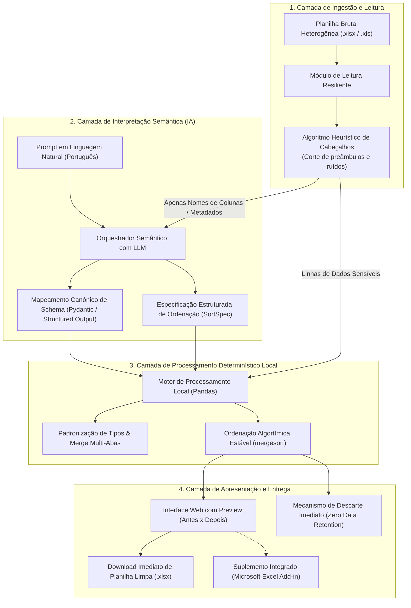
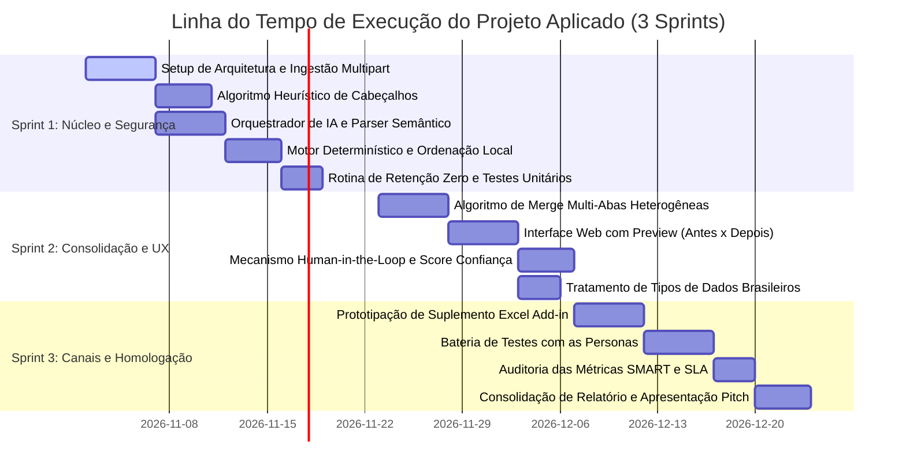

# Escopo Pretendido, Requisitos da Solução e Cronograma de Sprints
**Projeto Aplicado:** Organizer App — Organizador Inteligente de Dados e Planilhas  
**Instituição:** XP Educação (XPE) — Pós-Graduação em Inteligência Artificial e Engenharia de Software  
**Data:** 01 de Novembro de 2026  
**Status:** Documento de Engenharia de Requisitos e Planejamento Ágil (Seção 1.2.3 do Relatório)

---

## 1. Visão Geral do Escopo Pretendido da Solução

O **Organizer App** tem como objetivo transformar o cenário caótico de manipulação manual de planilhas heterogêneas no ambiente corporativo em um fluxo de trabalho ágil, seguro e determinístico de poucos segundos. 

A solução é desenhada como uma **plataforma horizontal e agnóstica a dados**, combinando a flexibilidade semântica de modelos de linguagem de grande porte (LLMs) com o rigor matemático e a velocidade de algoritmos determinísticos locais de manipulação tabular.

### 1.1. Arquitetura Funcional em Camadas

---

## 2. Lista Estruturada de Requisitos da Solução

Os requisitos foram levantados e consolidados com base nas dores operacionais das personas (**Carlos Eduardo**, **Mariana Vasconcelos** e **Rodrigo Mendes**), na declaração do **Objetivo SMART** e na mitigação das incertezas priorizadas na **Matriz GUT de Hipóteses (H1 a H9)**.

---

### 2.1. Requisitos Funcionais (RF)

| ID | Nome do Requisito | Descrição Detalhada | Prioridade (MoSCoW) | Hipótese Vinculada |
| :---: | :--- | :--- | :---: | :---: |
| **RF-01** | **Ingestão Multipart de Planilhas** | O sistema deve aceitar o carregamento de arquivos de planilhas nos formatos Microsoft Excel OpenXML (`.xlsx`) e legados (`.xls`) de até 20 MB e até 10.000 linhas via interface web. | **Must Have** | H3 |
| **RF-02** | **Detecção Heurística de Cabeçalhos** | O sistema deve inspecionar as primeiras 15 linhas do arquivo e identificar automaticamente a linha real de cabeçalho, descartando títulos institucionais, logos, linhas em branco e preâmbulos sem exigir edição prévia manual pelo usuário. | **Must Have** | H2 |
| **RF-03** | **Mapeamento Semântico de Schema via LLM** | O sistema deve enviar apenas a lista de cabeçalhos identificados para a API de IA e correlacionar termos sinônimos ou abreviações (ex.: *"Dt_Venda"*, *"Data Pedido"*, *"Data"*) para nomes canônicos padronizados utilizando validação com *Structured Outputs* (JSON Schema via Pydantic). | **Must Have** | H1 |
| **RF-04** | **Parser de Comandos em Linguagem Natural** | O sistema deve interpretar instruções digitadas pelo usuário em português corrente (ex.: *"ordene por data mais recente e depois valor"* ou *"junte as abas mensais e organize por cidade"*) e convertê-las em um objeto formal de ordenação e transformação. | **Must Have** | H4 |
| **RF-05** | **Ordenação Algorítmica Determinística Local** | O processamento das linhas de dados deve ser executado estritamente por algoritmos locais determinísticos (Pandas) com algoritmo estável (*mergesort*), garantindo que nenhum valor numérico ou textual seja modificado, inventado ou excluído. | **Must Have** | H6 |
| **RF-06** | **Consolidação de Múltiplas Abas (Merge Inteligente)** | O sistema deve permitir a consolidação de pastas de trabalho que contenham séries temporais ou regionais distribuídas em múltiplas abas heterogêneas, unificando os registros em uma tabela mestre única sem duplicar colunas canônicas. | **Should Have** | H8 |
| **RF-07** | **Interface Gráfica Web de Autosserviço** | O sistema deve fornecer uma interface web minimalista e responsiva em React/Tailwind, contendo área de arrastar-e-soltar (*drag and drop*) para envio de arquivos, campo de instrução textual, botões com modelos prontos (*templates*) e botão de download. | **Must Have** | H3 / H4 |
| **RF-08** | **Interface de Validação Humana (Human-in-the-Loop)** | O sistema deve exibir uma tela de pré-visualização interativa (Antes x Depois) com tabela comparativa e o score de confiança do mapeamento sugerido pela IA, permitindo ao usuário revisar e confirmar as alterações antes da exportação final. | **Should Have** | H7 |
| **RF-09** | **Higienização e Padronização de Tipos de Dados** | O sistema deve reconhecer e padronizar formatos brasileiros comuns: conversão de strings de datas para formato ISO/brasileiro (`DD/MM/AAAA`) e strings monetárias (`R$ 1.500,50`) para números decimais tratáveis, eliminando espaços vazios e caracteres corrompidos. | **Should Have** | H6 / H7 |
| **RF-10** | **Prototipação de Suplemento Nativo (Excel Add-in)** | O sistema deve fornecer um protótipo de suplemento lateral integrado ao Microsoft Excel via *Office JavaScript API*, permitindo ao usuário acionar a organização diretamente na planilha aberta sem troca de telas. | **Could Have** | H5 |

---

### 2.2. Requisitos Não Funcionais (RNF)

| ID | Categoria | Descrição do Requisito Não Funcional | Critério de Aceite / Métrica |
| :---: | :--- | :--- | :--- |
| **RNF-01** | **Desempenho / SLA** | O tempo total de resposta entre o upload do arquivo e a disponibilização do download final deve ser inferior a 15 segundos para planilhas de até 10.000 linhas. | Tempo total $\le 15$ segundos cronometrado por logs. |
| **RNF-02** | **Confiabilidade e Integridade** | Garantia matemática estrita de zero alucinação numérica: 100% dos dados das células originais devem ser preservados sem alteração de valores ou perda de registros. | Comparação automatizada (*checksum* / hash de linhas) pré e pós-processamento com 100% de match. |
| **RNF-03** | **Segurança e Privacidade (LGPD)** | A aplicação deve implementar arquitetura de *Zero Data Retention*. Apenas metadados (nomes de colunas) trafegam para a API de IA; os dados das linhas permanecem locais e todos os arquivos temporários são excluídos imediatamente pós-download. | 0 arquivos ou dados retidos em disco ou bancos pós-processamento. |
| **RNF-04** | **Eficiência de Custos** | O consumo de tokens por chamada de IA deve ser minimizado através de prompts enxutos focados estritamente em metadados, mantendo o custo de inferência abaixo de R$ 0,01 por arquivo processado. | Média $< 800$ tokens por execução; margem operacional bruta $> 90\%$. |
| **RNF-05** | **Usabilidade (UX)** | A interface deve apresentar curva de aprendizado zero para profissionais de negócios não técnicos (*Citizen Data Scientists*), com mensagens de status claras e feedback visual em tempo real. | Taxa de conclusão de tarefas $\ge 90\%$ sem necessidade de manual de instruções. |
| **RNF-06** | **Compatibilidade e Portabilidade** | A aplicação web deve operar de maneira responsiva e estável nos navegadores modernos de mercado: Google Chrome, Microsoft Edge, Mozilla Firefox e Safari. | Execução sem quebra de layout ou funcionalidade nos 4 navegadores. |

---

### 2.3. Regras de Negócio (RN)

* **RN-01 (Isolamento de Dados Sensíveis):** Em nenhuma hipótese o conteúdo textual ou numérico das linhas de clientes/fornecedores será transmitido para modelos externos de IA; apenas os rótulos de colunas e o comando do usuário compõem o payload enviado à nuvem.
* **RN-02 (Estabilidade Algorítmica):** O ordenamento de múltiplos critérios deve preservar a ordem original de registros empatados (*stable sorting* via algoritmo *mergesort*).
* **RN-03 (Tolerância a Preâmbulos):** O algoritmo de cabeçalho deve pontuar as linhas com base em proporção de texto, unicidade e preenchimento; caso não identifique linha com confiança $\ge 70\%$, deve assumir a primeira linha e notificar o usuário na interface.
* **RN-04 (Política de Expulgo de Temporários):** Arquivos salvos temporariamente na pasta de trabalho do servidor devem ter tempo de vida útil máximo (TTL) de 15 minutos, sendo limpos por rotina automática caso o usuário feche a conexão antes de concluir o download.

---

## 3. Planejamento das 3 Sprints de Desenvolvimento

O projeto é estruturado em **3 Sprints ágeis** de duração média de 2 semanas cada, cobrindo o horizonte temporal de **6 a 8 semanas** estabelecido no Objetivo SMART:

---

## 4. Backlog Detalhado de Tarefas (Formato Jira / Trello)

Abaixo estão detalhados os cartões de trabalho prontos para exportação e importação direta em ferramentas de gestão ágil como **Trello**, **Jira Software**, **Planner** ou **ClickUp**.

---

### 4.1. SPRINT 1: Núcleo da Solução, IA Semântica e Segurança
* **Meta da Sprint:** Desenvolver e testar o núcleo de processamento capaz de ingerir planilhas brutas com ruídos, interpretar o comando em linguagem natural, ordenar os dados localmente com 100% de integridade matemática e descartar arquivos temporários com segurança.
* **Hipóteses Validadas:** H6 (Determinismo), H1 (Mapeamento Semântico), H9 (Zero Data Retention), H4 (Linguagem Natural), H3 (Ingestão Tolerante) e H2 (Heurística de Cabeçalho).

#### Card 1.1: Setup da Arquitetura Backend e Ingestão Multipart
* **Chave / ID:** `TSK-S1-01`
* **Tipo:** Task / Enabler
* **Requisito:** `RF-01`, `RNF-06`
* **Story Points / Estimativa:** 3 pts (Média)
* **Descrição para o Jira/Trello:**
  > Configurar o ambiente backend em Python (Flask/FastAPI) e implementar o endpoint REST `/api/upload` capaz de receber arquivos multipart de planilhas `.xlsx` e `.xls` de até 20 MB, com validação de formato e armazenamento em diretório temporário isolado.
* **Critérios de Aceite (DoD):**
  - [x] Endpoint `/api/upload` aceita arquivos `.xlsx` e `.xls` com integridade de bytes.
  - [x] Validação de tamanho máximo (rejeita arquivos > 20 MB com HTTP 413).
  - [x] Sanitização segura de nomes de arquivo contra ataques de *Path Traversal*.
  - [x] Teste unitário de upload concluído com sucesso.

#### Card 1.2: Algoritmo Heurístico de Detecção de Cabeçalhos
* **Chave / ID:** `TSK-S1-02`
* **Tipo:** User Story
* **Requisito:** `RF-02`, `RN-03`
* **Story Points / Estimativa:** 5 pts (Alta)
* **Descrição para o Jira/Trello:**
  > Como operador de dados, quero que o sistema identifique automaticamente onde começa a tabela de dados, para que eu não precise abrir o arquivo e deletar manualmente logos, títulos institucionais e linhas vazias no topo.
* **Critérios de Aceite (DoD):**
  - [x] O algoritmo inspeciona as primeiras 15 linhas calculando scores de densidade, unicidade de strings e continuidade.
  - [x] Ignora de 1 a 10 linhas de ruído em planilhas reais de teste corporativo.
  - [x] Identifica a linha de cabeçalho com acerto em $\ge 95\%$ das amostras.
  - [x] Retorna os nomes brutos das colunas extraídas e o índice da primeira linha de dados.

#### Card 1.3: Orquestrador Semântico com LLM e Saídas Estruturadas
* **Chave / ID:** `TSK-S1-03`
* **Tipo:** User Story
* **Requisito:** `RF-03`, `RF-04`, `RNF-04`
* **Story Points / Estimativa:** 5 pts (Alta)
* **Descrição para o Jira/Trello:**
  > Como usuário corporativo, quero digitar instruções de organização em português corrente, para que o sistema traduza meu pedido em regras de mapeamento de colunas e ordenação sem exigir código ou fórmulas.
* **Critérios de Aceite (DoD):**
  - [x] Integração com API de LLM via *Structured Outputs* com modelo Pydantic (`MappingProposal` e `SortSpec`).
  - [x] Envio exclusivo de metadados (nomes de colunas e texto de instrução); zero linhas trafegadas.
  - [x] Assertividade de mapeamento semântico $\ge 90\%$ em testes com sinônimos de 5 setores.
  - [x] Consumo médio por chamada inferior a 800 tokens (custo $< \text{R\$} 0,01$).

#### Card 1.4: Módulo de Processamento Determinístico e Ordenação Local
* **Chave / ID:** `TSK-S1-04`
* **Tipo:** User Story
* **Requisito:** `RF-05`, `RNF-02`, `RN-02`
* **Story Points / Estimativa:** 5 pts (Alta)
* **Descrição para o Jira/Trello:**
  > Como analista financeiro/operacional, quero que os dados sejam ordenados e renomeados localmente com exatidão matemática, para ter certeza absoluta de que nenhum número ou linha foi alterado ou inventado pela IA.
* **Critérios de Aceite (DoD):**
  - [x] Mapeamento canônico das colunas e execução de ordenação multi-critério via Pandas com `mergesort` estável.
  - [x] Teste comparativo (*hash* de células) comprovando 100% de integridade numérica pré e pós-processamento.
  - [x] Geração de arquivo binário `.xlsx` de saída limpo e formatado via openpyxl.
  - [x] Tempo de processamento local $< 2$ segundos para 10.000 linhas.

#### Card 1.5: Rotina de Descarte Imediato e Governança LGPD
* **Chave / ID:** `TSK-S1-05`
* **Tipo:** Enabler / Segurança
* **Requisito:** `RNF-03`, `RN-04`
* **Story Points / Estimativa:** 2 pts (Baixa)
* **Descrição para o Jira/Trello:**
  > Implementar o ciclo de vida seguro de dados no servidor garantindo que arquivos temporários sejam expurgados imediatamente após a entrega do binário via *streaming* HTTP, com rotina de limpeza periódica de contingência.
* **Critérios de Aceite (DoD):**
  - [x] Arquivo de upload e arquivo de saída descartados logo após o encerramento do download pelo cliente.
  - [x] Rotina assíncrona de limpeza de arquivos com tempo de vida superior a 15 minutos (TTL).
  - [x] Auditoria de logs registrando 0 arquivos mantidos em disco após o fluxo.

---

### 4.2. SPRINT 2: Consolidação Multi-Abas, Interface e Validação Humana
* **Meta da Sprint:** Expandir o poder de manipulação com suporte a junção inteligente de abas (merge), enriquecer o pré-tratamento de formatos brasileiros e disponibilizar a interface web com tela de pré-visualização comparativa e aprovação humana.
* **Hipóteses Validadas:** H8 (Merge de Abas) e H7 (Human-in-the-Loop com Preview).

#### Card 2.1: Mecanismo de Merge e Consolidação de Múltiplas Abas
* **Chave / ID:** `TSK-S2-01`
* **Tipo:** User Story
* **Requisito:** `RF-06`, `RN-01`
* **Story Points / Estimativa:** 5 pts (Alta)
* **Descrição para o Jira/Trello:**
  > Como coordenadora de BPO financeiro (Mariana), quero consolidar planilhas com relatórios mensais ou extratos divididos em várias abas em uma tabela única, para eliminar horas de copia-e-cola manual.
* **Critérios de Aceite (DoD):**
  - [x] Identificação e leitura de todas as abas de uma mesma pasta de trabalho `.xlsx`.
  - [x] Aplicação do mapeamento semântico canônico em cada aba individualmente.
  - [x] Concatenação vertical das linhas alinhando colunas correspondentes sem duplicação de schema.
  - [x] Adição opcional de coluna identificadora da aba de origem (ex.: `aba_origem: "Janeiro"`).

#### Card 2.2: Construção da Interface Web Responsiva em React
* **Chave / ID:** `TSK-S2-02`
* **Tipo:** User Story
* **Requisito:** `RF-07`, `RNF-05`, `RNF-06`
* **Story Points / Estimativa:** 5 pts (Alta)
* **Descrição para o Jira/Trello:**
  > Como gestor de confecção (Carlos), quero acessar uma interface web visualmente limpa onde eu possa arrastar minha planilha e digitar o que preciso, com feedback imediato de progresso.
* **Critérios de Aceite (DoD):**
  - [x] Componente de drag and drop para upload com validação visual de extensões aceitas.
  - [x] Campo de texto estilizado para digitação de comandos em linguagem natural.
  - [x] Botões de atalho rápido (*templates*) para casos frequentes ("Organizar por data", "Consolidar abas").
  - [x] Indicador de carregamento e barra de status durante o processamento.

#### Card 2.3: Tela de Pré-Visualização Interativa (Antes x Depois) e Score de Confiança
* **Chave / ID:** `TSK-S2-03`
* **Tipo:** User Story
* **Requisito:** `RF-08`, `RNF-05`
* **Story Points / Estimativa:** 5 pts (Alta)
* **Descrição para o Jira/Trello:**
  > Como operador corporativo, quero inspecionar na tela uma comparação antes e depois do mapeamento sugerido com a porcentagem de confiança da IA, para aprovar com segurança antes de baixar o arquivo.
* **Critérios de Aceite (DoD):**
  - [x] Tabela interativa exibindo as primeiras 10 linhas da planilha bruta vs. planilha tratada.
  - [x] Exibição visual do de-para de colunas (ex.: `Dt_Venda` $\rightarrow$ `data_pedido` - Confiança: 94%).
  - [x] Botão de confirmação para disparo do download e botão de ajuste manual em caso de divergência.

#### Card 2.4: Módulo de Higienização de Tipos de Dados Brasileiros
* **Chave / ID:** `TSK-S2-04`
* **Tipo:** User Story
* **Requisito:** `RF-09`
* **Story Points / Estimativa:** 3 pts (Média)
* **Descrição para o Jira/Trello:**
  > Como analista de compras (Rodrigo), quero que valores monetários com símbolo de real e datas em formatos brasileiros sejam convertidos para tipos numéricos e de data tratáveis, para poder aplicar filtros sem erros.
* **Critérios de Aceite (DoD):**
  - [x] Tratamento de valores de moeda brasileira (remoção de `R$`, troca de vírgula decimal e pontos de milhar).
  - [x] Padronização de datas para formato `DD/MM/AAAA` com tratamento de células com formatação mista.
  - [x] Remoção de espaços duplos e caracteres invisíveis em strings de texto.

---

### 4.3. SPRINT 3: Canais Nativos, Homologação com Personas e Pitch
* **Meta da Sprint:** Prototipar o suplemento integrado para Microsoft Excel (Add-in), realizar baterias de testes práticos com arquivos reais das personas, auditar o cumprimento das métricas SMART e consolidar os artefatos acadêmicos.
* **Hipóteses Validadas:** H5 (Suplemento Nativo Excel Add-in) e homologação geral das metas SMART.

#### Card 3.1: Prototipação do Suplemento Nativo (Microsoft Excel Add-in)
* **Chave / ID:** `TSK-S3-01`
* **Tipo:** User Story / Inovação
* **Requisito:** `RF-10`
* **Story Points / Estimativa:** 5 pts (Alta)
* **Descrição para o Jira/Trello:**
  > Como usuário intensivo de Excel, quero utilizar o Organizer App diretamente em um painel lateral dentro do próprio software, para não precisar alternar de janela ou abrir navegadores externos.
* **Critérios de Aceite (DoD):**
  - [x] Estruturação do arquivo de manifesto XML do Office Add-in compatível com Excel Online e Desktop.
  - [x] Painel lateral web responsivo consumindo a API local via *Office JavaScript API*.
  - [x] Leitura da seleção ativa da planilha diretamente pelo suplemento e devolução organizada na aba ativa.

#### Card 3.2: Bateria de Testes Experimentais com Amostras das Personas
* **Chave / ID:** `TSK-S3-02`
* **Tipo:** Task / Validação
* **Requisito:** `RNF-01`, `RNF-02`, `RNF-05`
* **Story Points / Estimativa:** 5 pts (Alta)
* **Descrição para o Jira/Trello:**
  > Conduzir baterias de testes práticos submetendo planilhas reais de confecção/grades (Carlos), conciliação de extratos contábeis (Mariana) e tabelas de fretes/cotações (Rodrigo) para aferição empírica de desempenho.
* **Critérios de Aceite (DoD):**
  - [x] Teste com no mínimo 5 arquivos de amostra para cada uma das 3 personas mapeadas.
  - [x] Medição de tempo de resposta confirmando SLA $< 15$ segundos em todos os lotes de teste.
  - [x] Assertividade de mapeamento de colunas comprovada em $\ge 90\%$.
  - [x] Registro fotográfico e evidências de tela para compor o Capítulo 2 do relatório.

#### Card 3.3: Auditoria Final das Métricas SMART e Teste de Carga
* **Chave / ID:** `TSK-S3-03`
* **Tipo:** Task / QA
* **Requisito:** `RNF-01`, `RNF-02`, `RNF-03`, `RNF-04`
* **Story Points / Estimativa:** 3 pts (Média)
* **Descrição para o Jira/Trello:**
  > Executar testes de carga volumétrica (planilhas de 1.000 a 10.000 linhas) e auditoria de conformidade, consolidando a planilha de indicadores quantitativos de aceite.
* **Critérios de Aceite (DoD):**
  - [x] Aferição do tempo médio de execução e desvio padrão.
  - [x] Validação da redução de tempo de manipulação manual $\ge 70\%$ comparada ao método tradicional.
  - [x] Confirmação de 0 arquivos retidos e consumo médio de tokens dentro do teto orçamentário.

#### Card 3.4: Consolidação do Relatório do Projeto e Apresentação Pitch
* **Chave / ID:** `TSK-S3-04`
* **Tipo:** Task / Documentação
* **Requisito:** `Entrega Acadêmica XP Educação`
* **Story Points / Estimativa:** 3 pts (Média)
* **Descrição para o Jira/Trello:**
  > Consolidar os resultados empíricos, evidências das Sprints e lições aprendidas no Relatório do Projeto Aplicado (`.docx`) e nos slides de Pitch (`.pptx`) para avaliação final da banca.
* **Critérios de Aceite (DoD):**
  - [x] Preenchimento integral dos Capítulos 2 (Área de Experimentação) e 3 (Considerações Finais).
  - [x] Anexação de todas as evidências visuais e tabelas de validação experimental.
  - [x] Revisão final de normas e conformidade com o template oficial da instituição.

---

## 5. Tabela Consolidada para Importação Direta em Ferramentas Ágeis (Jira / Trello / CSV)

A Tabela 5.1 sintetiza o backlog completo com todos os campos necessários para importação em massa via planilha ou CSV nas plataformas de gestão de projetos:

### Tabela 5.1: Matriz de Importação de Tasks do Backlog

| Sprint | ID da Task | Título da Tarefa (Summary) | Tipo de Item | Prioridade | Story Points | Requisito Relacionado |
| :---: | :---: | :--- | :---: | :---: | :---: | :---: |
| **Sprint 1** | `TSK-S1-01` | Setup da Arquitetura Backend e Ingestão Multipart | Task | Alta | 3 | `RF-01`, `RNF-06` |
| **Sprint 1** | `TSK-S1-02` | Algoritmo Heurístico de Detecção de Cabeçalhos | User Story | Alta | 5 | `RF-02`, `RN-03` |
| **Sprint 1** | `TSK-S1-03` | Orquestrador Semântico com LLM e Saídas Estruturadas | User Story | Alta | 5 | `RF-03`, `RF-04`, `RNF-04` |
| **Sprint 1** | `TSK-S1-04` | Módulo de Processamento Determinístico e Ordenação Local | User Story | Crítica | 5 | `RF-05`, `RNF-02`, `RN-02` |
| **Sprint 1** | `TSK-S1-05` | Rotina de Descarte Imediato e Governança LGPD | Enabler | Alta | 2 | `RNF-03`, `RN-04` |
| **Sprint 2** | `TSK-S2-01` | Mecanismo de Merge e Consolidação de Múltiplas Abas | User Story | Alta | 5 | `RF-06`, `RN-01` |
| **Sprint 2** | `TSK-S2-02` | Construção da Interface Web Responsiva em React | User Story | Alta | 5 | `RF-07`, `RNF-05`, `RNF-06` |
| **Sprint 2** | `TSK-S2-03` | Tela de Preview Interativo (Antes x Depois) e Confiança | User Story | Média | 5 | `RF-08`, `RNF-05` |
| **Sprint 2** | `TSK-S2-04` | Módulo de Higienização de Tipos de Dados Brasileiros | User Story | Média | 3 | `RF-09` |
| **Sprint 3** | `TSK-S3-01` | Prototipação do Suplemento Nativo (Excel Add-in) | Inovação | Baixa | 5 | `RF-10` |
| **Sprint 3** | `TSK-S3-02` | Bateria de Testes Experimentais com Amostras das Personas | Validação | Alta | 5 | `RNF-01`, `RNF-02`, `RNF-05` |
| **Sprint 3** | `TSK-S3-03` | Auditoria Final das Métricas SMART e Teste de Carga | QA | Alta | 3 | `RNF-01`, `RNF-03`, `RNF-04` |
| **Sprint 3** | `TSK-S3-04` | Consolidação do Relatório do Projeto e Apresentação Pitch | Documentação | Alta | 3 | `Entrega Acadêmica XPE` |

---

## 6. Conclusão da Seção de Escopo e Cronograma

O detalhamento dos requisitos funcionais, não funcionais e regras de negócio, articulados em um cronograma estrito de 3 Sprints ágeis, assegura clareza de escopo e alta rastreabilidade entre os objetivos estratégicos e o plano de desenvolvimento. A organização das tarefas com critérios objetivos de aceite viabiliza a gestão visual do projeto em ferramentas de mercado (Jira/Trello), garantindo previsibilidade para a subsequente validação prática no Capítulo 2 (*Área de Experimentação*).

